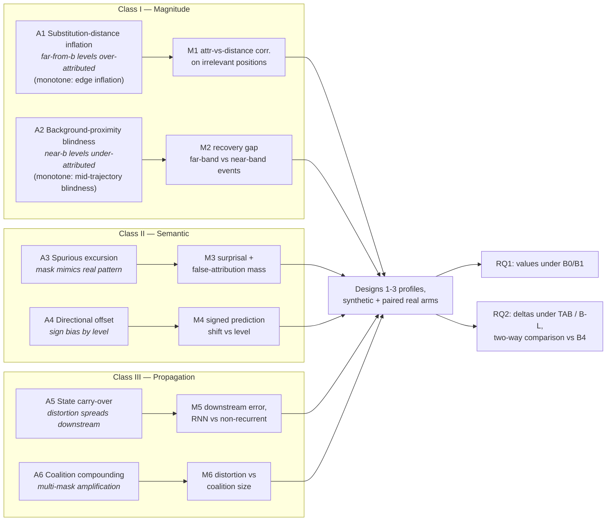

# Masking Backgrounds for Shapley-Based Temporal Attribution under Mean-Nonstationarity
## Research Methodology Proposal — v5.1

**Changes in v5.1** (three review comments incorporated; no new citations, figures-of-record, or numeric claims introduced):
1. **A-taxonomy generalized.** A1/A2 (and, for consistency, A3/A4) are now stated in a general **level-indexed** form valid under any mean-nonstationarity, with the monotone-trend readings ("edge inflation", "mid-trajectory blindness") retained as named specializations. New *Class I invariant* box and *level-set geometry* box in 1.2; 3.2.2 item 1 rewritten accordingly; M2 and M4 redefined against level rather than time position; new **Fig. L**.
2. **Material resequenced.** The instrument set moved from §3.8 to **§3.3**, so metrics are defined immediately after the artifacts they measure and before every hypothesis that references them; all cross-references renumbered (map at the end of this box). Added a document map and a Section-3 reading-order note. New **Fig. M** (metric signatures: ideal vs. artifact reading, one panel per metric).
3. **TAB assumptions and operating envelopes.** New 3.5.2a (TAB-state) and 3.5.3a (TAB-traj) giving assumptions with diagnostics, strengths, limitations, and target regime; new 3.5.3b selection guide plus five pre-declared operating-envelope predictions E1–E5 bound to existing arms (one cheap addition: a fleet-size ablation for B2).

Folded in from the outstanding v5 edit list: robust bin statistic variant for B2; index-channel selection procedure under multiple drifting channels; position-stratified fit-noise diagnostic for B3; universal level-index framing. *Still outstanding:* the windowed-training paragraph for 3.5.2.

**Section renumbering, v5.0 → v5.1:** 3.8→3.3 · 3.3→3.4 · 3.4→3.5 · 3.5→3.6 · 3.6→3.7 · 3.7→3.8. All other numbers unchanged.

**Proposed paper title (primary, recommended):**
> *Substitution Artifacts in Shapley-Based Temporal Attribution: Characterizing and Correcting Masking-Background Bias on Mean-Nonstationary Time Series*

**Alternative titles:**
- Thesis-forward variant (declarative, uses the paper's central claim as a hook): *The Explainer Assumes Stationarity Where the Model Does Not: Masking-Background Bias and Trend-Aware Corrections for Temporal Shapley Attribution*
- Compact ML-venue variant: *Trend-Aware Masking Backgrounds for Temporal Shapley Attribution on Mean-Nonstationary Data*

Final title choice with the supervisor at venue decision.

**One-line research question:** When a temporal attribution method removes a timestep to measure its importance, it must substitute something in the gap — on mean-nonstationary data, the standard substitutes (global mean, zeros) create sequences that cannot occur. How much does this distort explanations, and what should the substitute be instead?

**Document map.** §0 fixes vocabulary and scope discipline. §1 states the problem and the hypothesized artifacts (A1–A6). §2 places the work against four literatures. §3 is the design proper, ordered questions → metrics → methods → benchmark → evaluation rules (its own reading-order note opens the section). §4–§7 cover expected outcomes, contributions, risks, and naming. §8 maps the design onto the manuscript. §9 is the citation-verification ledger; §10 the framing check.

**Genre:** XAI methods paper. Battery RUL estimation is the flagship real-world validation case, not the research subject; domain-specific vocabulary is confined to the application sections. The rationale for choosing battery RUL as the flagship domain is stated explicitly in 3.8.

---

## 0. Terminology, Notation, and Scope Discipline

This section is normative for the whole document and the manuscript.

### 0.1 Scope vocabulary — one rule

- **Mean-nonstationarity** (established concept): the marginal expectation of the signal depends on time, E[x_t] = μ(t) with μ non-constant. This is the **general condition under which the mechanism operates**, and the term used for all mechanism-level and design-level claims.
- **Monotone trend** (established): the special case where μ(t) is monotone (e.g., irreversible equipment wear). This term is used **only** to delimit the *evaluated scope* of this paper's experiments — never to describe the mechanism, the method design, or the gap.
- The words **"trended data"** and **"monotone drift"** are removed from the document as free-floating vocabulary. Where an informal adjective is unavoidable (e.g., in the benchmark name), "trended" is used strictly as shorthand for "exhibiting sustained mean-nonstationarity" and is defined as such at first use in the manuscript.

Rule of thumb enforced throughout: *mechanism and methods are stated for mean-nonstationarity; experiments and claims are stated for the monotone-trend instance; nothing is claimed beyond the tested scope.* The extrapolation question this rule raises — what, if anything, the monotone-trend results license for general mean-nonstationarity — is not left implicit: it is treated explicitly in 3.2, with a dedicated scope-probe experiment.

### 0.2 Term status table

| Term | Status | Anchor / note |
|---|---|---|
| off-manifold / on-manifold (masking, value functions) | **Established** | Standard in the Shapley value-function literature (Frye et al., ICLR 2021; Yeh et al., AISTATS 2022 — ledger, Section 9). Used as-is. |
| OOD — **out-of-distribution** | **Established**, but must be expanded and defined at first use | First use in the manuscript: "out-of-distribution (OOD): inputs lying outside the support of the training distribution, on which model behavior is unconstrained by training." Thereafter the acronym may be used. |
| mean-nonstationarity | **Established** | Defined formally at first use as in 0.1. |
| missingness bias | **Established** | Jain et al., ICLR 2022 (image domain); adopted when citing that literature. |
| level / **level index** | **Established** (adapted) | *Level* is the established name for the slowly-varying mean component in structural time-series models; this document uses it as the **general organizing coordinate** of the whole taxonomy — the artifacts and their instruments are indexed by level, not by time (1.2). The **level index** is any past-only observable estimate of it (3.5.2). Under monotone μ, level and trend position are in bijection; under non-monotone μ they are not, which is exactly the distinction 3.2.2 turns on. |
| trend position | **Paper-defined** | *The level a sequence has reached along its mean trajectory μ(t).* Not an established term of art; the closest established relatives are the "level" component of structural time-series models and the "health/degradation state" of PHM. The manuscript defines it explicitly at first use and anchors it to both relatives in one sentence, then uses it consistently. |
| process state | **Paper-defined** | *An observable summary of trend position computed from past observations only.* Anchored at first use to the established PHM notion of an observable **health indicator**. The leakage-relevant distinction (observable state vs. true latent progression, which is the prediction target) is stated where the term is defined; formalized in 3.5. |
| counter-trend excursion | **Paper-defined** | *A transient, temporary reversal against the mean trajectory.* The established domain instance is **capacity regeneration** in lithium-ion batteries (rest-period mechanism; documented for the NASA and CALCE datasets — ledger, Section 9). The manuscript introduces the generic term via the domain term, not the other way around. |
| substitution surprisal | **Paper-defined** | Defined in 3.10; explicitly flagged as a paper-local measurement device, not established vocabulary. |
| knee (knee point, knee onset) | **Established (domain)** | Standard in battery degradation literature; the nonlinear "knee" regime and its pathways are documented in Attia et al., J. Electrochem. Soc. 2022 (ledger, Section 9); specific knee-*identification* method references still under verification. |

**Manuscript obligation:** every paper-defined term gets (i) an explicit definition at first use, (ii) a one-sentence anchor to its nearest established relative, and (iii) an entry in a notation/glossary table. Reviewers must never have to guess whether a term is ours or the field's.

---

## 1. Problem Statement

### 1.1 The mechanism

Shapley-based temporal attribution (TimeSHAP and relatives) defines the importance of timestep *t* as the change in model output when *t* is "absent." Absence is operationalized by substitution: masked entries are replaced with a background value. TimeSHAP itself requires a **user-supplied background instance** and describes the substitution as replacing the original value with an uninformative background — "usually 0 or the average value on the training dataset" (authors' description; the reference implementation's tutorials construct a feature-wise average event). Occlusion / feature-ablation methods commonly default to constant zero baselines. Our ACIIDS paper used the global feature-wise mean over training sequences (Eq. 3). The library delegates the choice; the field defaults to unconditional means or zeros; no guidance exists for mean-nonstationary data.

On **mean-nonstationary data** — where E[x_t] changes with t — an unconditional substitute is systematically wrong in a *position-dependent* way. In the monotone-trend instance (our evaluated scope; e.g., irreversible equipment wear), both defaults produce sequences that cannot occur:

- **Zeros:** all channels drop to zero for one step — the process "vanishes" for a step and resumes.
- **Global mean:** a sequence far along its trajectory exhibits one mid-trajectory observation — the process briefly reverts to a state it has irreversibly left.

The model's output on such inputs is extrapolation outside the training manifold — the substituted input is **out-of-distribution (OOD): it lies outside the support of the training distribution, so the model's behavior on it is unconstrained by training**. The attribution inherits an unknown mixture of (a) genuine information loss and (b) the model's arbitrary reaction to an impossible input, summed into one number that cannot be decomposed.

> **Thesis (stated as such in the paper).**
> **The explainer assumes stationarity where the model does not.** A deep sequence model trained on a fleet of degradation trajectories legitimately consumes mean-nonstationary inputs — the trend level *is* the signal. An unconditional masking background silently imports a stationarity assumption the data violates: that timesteps are exchangeable with a single position-independent substitute. The bias we characterize is the price of that hidden assumption, and the fix is to make the background respect what the model already knows.
>
> This sentence is the paper's organizing claim. Placement: closing sentence of the abstract's problem statement; a displayed, referenced statement in the Introduction; the opening of the Discussion; candidate title material (alternative title above).

### 1.2 Hypothesized substitution artifacts — the A-taxonomy

On stationary data, off-manifold masking adds unstructured error. Under mean-nonstationarity it adds **structured bias**, and the structuring variable is the **level** the process has reached — E[x_t] = μ(t) — not time as such. Stating this precisely is what makes the taxonomy general rather than an artifact of the monotone case:

> **Class I invariant (general form; no shape assumption).** With an unconditional background b, the perturbation masking injects at (t,c) is the gap |x_t^(c) − b^(c)|. That gap decomposes into a systematic part |μ^(c)(t) − b^(c)| and a noise part; only the first is structured, and under mean-nonstationarity it varies systematically across the sequence because μ does. **Class I is the hypothesis that attribution magnitude inherits that structure** — that it is modulated by the level–background gap independently of information content. Equivalently in information-theoretic terms (3.10): the substitute's surprisal given its context is level-dependent, so masking injects level-dependent novelty the model must react to. Nothing in this statement requires μ to be monotone, ordered, or of any parametric shape.

Artifacts, grouped in three classes. Each is stated first in its **general (level-indexed) form**, then in the **monotone-trend instance** that this paper evaluates — the instance names are specializations, not the definitions. Full description ↔ metric ↔ test mapping: 3.3, Fig. T, Fig. M.

**Class I — Magnitude artifacts** (attribution size driven by substitution geometry, not information):
- **A1 Substitution-distance inflation** *(general)*: observations whose level lies far from b are perturbed hard → attributions inflated independently of information content.
  *Monotone-trend instance — "edge inflation":* when μ is monotone it is injective in t, so level identifies position; the far-from-b level band is the trajectory's two **extremes**, and the artifact surfaces as inflated attribution early and late in the sequence.
- **A2 Background-proximity blindness** *(general)*: observations whose level lies near b are barely perturbed → attributions structurally compressed toward zero regardless of informativeness.
  *Monotone-trend instance — "mid-trajectory blindness":* the near-b level band is the trajectory's **middle**, so mid-sequence observations are the blind ones.

> **Level-set geometry — why the two formulations differ (and what depends on it).** A1 and A2 are the two tails of one statement, and both are defined on **level bands**: {t : |μ(t) − b| large} and {t : μ(t) ≈ b}. Pulling a level band back onto the time axis is a bijection only when μ is injective. Under **monotone** μ the bands pull back to intervals — extremes vs. middle — so time position is an adequate index and the instance names above are exact. Under **non-monotone** μ (seasonal, cyclic, regime-switching) the *same* bands pull back to scattered or recurrent sets of times: the bias is equally present, but it has no monotone temporal signature, and any instrument indexed by *time* rather than *level* will fail to detect it. **Binding design consequence:** the Class I instruments (M1, M2) and the Class II instrument M4 are defined against **substitution distance / level**, never against t (3.3). They therefore measure the general form directly and run **unchanged** on non-monotone profiles (3.2.3). See Fig. L.

**Class II — Semantic artifacts** (the substitute *means* something to the model):
- **A3 Spurious-excursion response** *(general)*: inserting a value at background level into a window whose level is far from b manufactures an abrupt transient toward b and back — the morphology of a genuine transient excursion of the process, which the model may have learned to react to. Measured "importance" then partly reflects the model firing on a pattern the masking itself created.
  *Monotone-trend instance:* a mean-level step inserted into a late-trajectory window mimics a **counter-trend excursion** (capacity regeneration in the battery case).
- **A4 Directional offset** *(general)*: masking pulls the model's reading of the window's level toward b, so the signed prediction shift is systematically related to the sign of (b − level) — a sign bias originating in substitution geometry, not in information.
  *Monotone-trend instance:* replacing late-trajectory values with mid-trajectory values pushes predictions toward earlier trend positions, giving late-window attributions a consistent sign bias (an optimistic RUL error in the flagship domain).

**Class III — Propagation artifacts** (single-step distortion spreads; both statements are already level-free):
- **A5 Recurrent state carry-over:** in recurrent models, a masked timestep corrupts the hidden state, so the distortion propagates to all subsequent timesteps' processing — the artifact is not local to the masked position.
- **A6 Coalition compounding:** Shapley evaluates coalitions with multiple timesteps masked simultaneously, compounding A1–A5 within single model calls.

**Artifact → metric binding (definitions in 3.3):** A1→M1, A2→M2, A3→M3, A4→M4, A5→M5, A6→M6 — one primary instrument per artifact, so that every hypothesis in this document is validated or falsified by a named, pre-declared measurement.

**Comprehensiveness discipline:** the taxonomy spans {origin: magnitude / semantics / propagation} × {corrupted quantity: size, sign, spatial structure}. A related-work pass maps every masking-artifact effect documented in adjacent literatures (image missingness bias, tabular off-manifold, TS perturbation) onto the taxonomy; any effect that does not fit forces an extension before experiments start.

**Nonlinear regimes near trajectory extremes (amplifier, not a new class):** many mean-nonstationary processes turn sharply nonlinear near their extremes (e.g., terminal knee behavior; low-charge effects in battery signals). This is not a seventh artifact: it is a hypothesized **amplifier** of A1/A3/A4 — substitution distance is largest in the far-from-b level band (the trajectory's extremes in the monotone instance), which is also where the model is least linear, so artifact magnitude is plausibly a function of local trajectory curvature, not distance alone. It is additionally a **validity condition for the proposed fix** (a smooth conditional background can be wrong exactly at a sharp knee; see 3.4/3.7). Handled by curvature-stratified reporting of M1–M4 and a sharp-knee stress profile — not by expanding the research questions. Model misfit in extreme regimes remains out of scope by the standing discipline: attributions explain the model, not the data; our claim is only that the background must not *add* distortion.

### 1.3 What is at stake, and relation to ACIIDS

Published findings — including our own — are currently indistinguishable from these artifacts. In the ACIIDS paper: attribution growth toward the end of the sequence (predicted by A1), dominance of first and most recent steps (A1+A2), and the pruning figure (16.9% at 5% tolerance) all sit downstream of the global-mean background. The paper's own limitations section anticipated this, and its Reviewer 4 flagged the masking baseline as weak and potentially OOD-generating.

**ACIIDS is cited prior work and the case-study target — not the methodological base.** Because the ACIIDS pipeline carries a suspected future-leakage issue, no experiment runs on the original pipeline. A corrected pipeline (leakage-free fleet-level normalization; past-only feature computation; retrained model) is a Phase-0 prerequisite; all results — including the consequence case study (3.14) — are produced on the corrected stack. Concepts, feature definitions, and TimeSHAP tooling are reused; the original training/evaluation protocol is not.

### 1.4 Anticipated questions (answered up front, because reviewers will ask)

**Q1: "Why not just detrend the data?"**

1. **Post-hoc XAI must explain the deployed model as it is.** The installed base of prognostics models is trained on raw inputs. Detrending is a *modeling* intervention that produces a different model; it does not explain the existing one.
2. **Detrending only at explanation time recreates the problem.** Substituting a detrended value into a raw-input model (or explaining raw inputs of a detrend-trained model) evaluates the model off its training distribution — the same OOD mechanism.
3. **On prognostic tasks the trend level is signal, not nuisance.** Models legitimately consume absolute trend position (it carries most of the label information); removing it changes the task.
4. Even detrend-trained models may retain residual nonstationarity (e.g., variance growth), leaving a version of the problem in place.

An optional **detrended-pipeline ablation arm** (Phase 2) tests this empirically: train the cross-check model on detrended features and report (i) predictive cost and (ii) whether background sensitivity persists. Also listed as a risk row.

**Q2: "If the data is non-stationary, why fit a model on it at all?"**

The classical stationarity requirement concerns *statistical inference on a single series over time* (autoregressive forecasting, where estimator guarantees assume a stable generating law and nonstationarity invites spurious associations). Prognostics regression is a different learning problem: a supervised mapping from windowed covariate sequences to labels, trained over a **population of trajectories** (a fleet of units). What must be stable is the distribution over (window, label) pairs *across units* — not the signal along time — and the within-sequence nonstationarity is not a nuisance but the predictive signal itself. Deep sequence models impose no stationarity assumption; the genuine pitfalls in this setting are leakage and normalization discipline, which the corrected pipeline addresses (1.3). This objection feeds directly into the thesis box of 1.1: the *model* legitimately consumes mean-nonstationary inputs, while the default masking background silently imports a stationarity assumption the data violates.

---

## 2. Novelty and Prior-Art Map

Four literatures have engaged the problem; none solves it at this intersection. (Verification status: Section 9 ledger; novelty searches most recently re-run 2026-07-19, no direct competitor on trend-/state-conditional backgrounds for temporal Shapley found.)

| Literature | Representative work | What it established | Why it does not close the gap |
|---|---|---|---|
| Tabular Shapley: off-manifold problem | Frye et al., ICLR 2021; Aas et al., Artif. Intell. 2021; Sundararajan & Najmi, ICML 2020; Chen et al. 2020 ("true to the model / true to the data"); Janzing et al., AISTATS 2020; Yeh et al., AISTATS 2022 (on/off-manifold value-function axioms) | Off-manifold Shapley evaluates the model on unrealistic spliced inputs and can produce incorrect explanations; fixes via conditional expectations, generative modeling, learned value functions; recent theory continues in this line (flow-based on-manifold attribution, arXiv:2603.05093 — static/vision-oriented) | Static data, generic manifolds, generative machinery required; does not exploit that under mean-nonstationarity the manifold has a known low-dimensional organizing variable (trend position), making the fix cheap |
| Image XAI: masking artifacts & realistic infilling | Missingness bias: Jain et al., ICLR 2022 (models *use* blacked-out regions). Fixes: blur (Fong & Vedaldi, ICCV 2017), generative infilling (FIDO, ICLR 2019; LIME-G), baseline distributions (G-DeepSHAP, Nat. Commun. 2022); post-hoc output calibration (MCal, arXiv:2603.04831 — medical vision/language/tabular, not temporal) | The artifact class is documented for constant-patch replacement; in-distribution replacement and, recently, output-space calibration are the remedies | Spatial data with no global organizing variable: bias is local/unstructured, fix requires an inpainting model (or calibrates outputs rather than fixing the substitute); no temporal ordering, no drift, no structured-bias analysis, regression under mean-nonstationarity untouched |
| Time-series saliency (non-Shapley): realistic perturbations | FIT + Augmented Feature Occlusion (Tonekaboni et al., NeurIPS 2020 — OOD-counterfactual motivation; carry-forward substitution); Dynamask (ICML 2021 — temporal blur); ExtremalMask (ICML 2023 — learned perturbations); ContraLSP (Liu et al., ICLR 2024 — contrastive in-distribution perturbations with a smoothness/trend function for the *mask*) | OOD-perturbation problem recognized for time series; plausible, distribution-preserving perturbations improve explanation quality | Abandons the Shapley framework (no efficiency axiom → no additivity, no pruning certificate); evaluation ecosystems center on classification and (quasi-)stationary or state-switching generators — see the benchmark claim below |
| Temporal Shapley methods | TimeSHAP (KDD 2021 — user-supplied background; zeros/average in practice); TSHAP (ECML PKDD 2025 — background "understudied"; centroid selection; regression gap named); GroupSegment-SHAP (arXiv:2601.06114, Jan 2026 — background-sensitivity measurements: TimeSHAP dataset-dependent, KernelSHAP most sensitive); Papadeas et al. (2026) | Background sensitivity measured; selection strategies among fixed backgrounds proposed | All proposed backgrounds remain **unconditional** (means, centroids, zeros, noise) — none conditions on temporal position or process state; trend-structured bias never characterized |

**Benchmark claim — precise formulation.** The defensible, precise claim — which the manuscript will carry — is:

> No existing time-series attribution benchmark provides **ground-truth importance labels in a regime of sustained, label-relevant mean-nonstationarity**. Established synthetic evaluation suites in this literature are built on (quasi-)stationary or regime/state-switching generators — HMM-style state data and spike injection on NARMA series (Tonekaboni et al., NeurIPS 2020; reused by the Dynamask, ExtremalMask, and ContraLSP evaluation suites). Where a trend appears in these suites at all — the linear trends added to feature channels of the Tonekaboni spike generator — it is incidental nuisance structure: the planted ground truth is trend-independent, the task is classification, and no instrument measures trend-position-dependent bias. Real-data evaluations (including WinTSR's regression arms on electricity, traffic, and MIMIC-III) have no attribution ground truth at all. Consequently the regime where substitution bias is *structured* — rather than noise-like — has never been measurable.

Generator-level verification status: the Tonekaboni Spike/State generators, the Dynamask state experiment, the ExtremalMask HMM experiment, and the ContraLSP Switch-Feature/State experiments have been audited against the primary papers (ledger, Section 9). Remaining obligation before submission: complete the per-experiment audit of the *full* Dynamask and ExtremalMask evaluation suites beyond their HMM/state experiments, and of any additional benchmark cited in the final related-work table.

**Gap statement:** background *sensitivity* is measured, and *selection among unconditional candidates* exists; what does not exist is (i) a characterization of the **structured, level-correlated bias** unconditional backgrounds induce under mean-nonstationarity (trend-position-correlated in the monotone instance), (ii) **conditional backgrounds** designed for mean-nonstationary data, (iii) any **ground-truth benchmark with sustained, label-relevant mean-nonstationarity**. Mean-nonstationarity both worsens the problem (structured bias, A1–A6) and cheapens the solution (conditioning on observable process state replaces generative modeling). Harder problem, cheaper fix — the intellectual core.

**Generality of the mechanism (framing, not overclaim):** the mechanism operates under **mean-nonstationarity in general** — whenever E[x_t] varies with t, an unconditional background is position-dependently wrong. The monotone-trend case is the sharpest instance (position is ordered; the bias becomes monotone-structured and interpretable) and is the **evaluated scope of this paper**. Seasonal and regime-switching nonstationarity are stated corollaries and future work; no claims are made beyond the tested scope. The proposed methods (3.4) are *designed* for the general condition, so that the scope limitation is evaluative, not architectural. What the monotone-trend experiments do and do not license for the general condition is analyzed in 3.2.

**Novelty positioning discipline — "if generative on-manifold masking exists, why will anyone use our results?"** Surrogate generative/imputation models for on-manifold masking are *established* (Frye; FIDO; LIME-G) and never claimed as our contribution — B4 in our design *is* that technique, instantiated as an established reference arm. The contribution survives, on four independent legs:
1. **The characterization is novel regardless of the fix.** A1–A6 with ground-truth quantification under mean-nonstationarity does not exist in any literature row above; it stands whatever the ordering among the proposed backgrounds and B4 turns out to be.
2. **The cheap fix is the open question, not the expensive one.** The established remedy requires building, training, and validating a generative/imputation model per dataset — a cost and competence barrier that is precisely why applied prognostics work keeps using library defaults; the surrogate is also a second model whose own failure modes can contaminate the explanation, and it has never been benchmarked on mean-nonstationary regression. Whether near-free conditioning on an observable process state matches, beats, or falls short of the generative remedy *on this data regime* is unknown and is what RQ2 measures. Every ordering is publishable (Section 4): "cheap fix suffices or wins" yields a drop-in recommendation; "only the imputer closes the gap" is a sharpened negative result the applied field needs to hear; "the imputer itself fails validity diagnostics" quantifies the adoption risk of the established remedy.
3. **The benchmark is novel.** No ground-truth attribution benchmark with sustained, label-relevant mean-nonstationarity exists (claim above); ours is released with paired real arms.
4. **The consequence case study is novel in kind:** a published attribution result re-examined under a corrected background on a corrected pipeline, with the leakage fix and the background fix de-confounded (3.14).

**Scope of affected methods:** everything that operationalizes absence by substitution — KernelSHAP-derived temporal methods (TimeSHAP, WindowSHAP, TSHAP, GS-SHAP), occlusion/feature ablation, and (via the baseline-input problem) Integrated Gradients. Attention weights are unaffected (no baseline) but were uncorrelated with prediction influence in our ACIIDS results (Spearman rho = 0.078), and are no refuge. Why claims made with one Shapley estimator are informative for this whole family is argued in 3.6.

**Mandatory novelty re-check before submission** — the neighborhood is active (missingness-bias calibration, arXiv:2603.04831, Mar 2026; flow-based on-manifold Shapley, arXiv:2603.05093, Mar 2026 — both verified non-temporal); searches re-run at submission; differentiation table maintained.

---

## 3. Research Questions and Method

**Reading order of this section, and why.** The chain runs *questions → what is measured → what is proposed → how it is defined → what it is evaluated on → how verdicts are reached*: 3.1 states the questions; 3.2 fixes what the monotone-trend experiments license for the general condition; **3.3 defines the instrument set, so that every subsequent hypothesis is written as a predicted movement of a named metric**; 3.4 proposes the background candidates as exactly such hypotheses; 3.5 gives their formal definitions, assumptions and operating envelopes; 3.6–3.8 fix the estimator, the benchmark and the flagship domain; 3.9–3.11 fix the evaluation rules, the interpretive lens and the real data; 3.12–3.14 cover models, phasing and the case study. (Changed in v5.1: the instrument set previously sat after the benchmark, which forced 1.2 and 3.4 to reference metrics that had not yet been defined.)

### 3.1 Research questions

- **RQ1 (Characterize):** How large and how structured is the distortion that default backgrounds (zeros, global mean) induce in temporal Shapley attributions on mean-nonstationary data? (Measures A1–A6 with the instrument set of 3.3, against exact ground truth on the synthetic arms.)
- **RQ2 (Fix):** Do trend-aware backgrounds reduce the distortion — measured on the *same* instrument set — and how do they compare, in both directions, with the established generative-imputer reference (B4)? *(Computational cost is reported descriptively — analytical complexity per background plus measured wall-clock per explanation as a table in the experimental setup — not investigated as a research question: the per-call overhead of the proposed backgrounds is a precomputation/lookup and requires estimation, not investigation.)*
- **RQ3 (Transfer):** Do the synthetic-benchmark verdicts transfer to the paired real datasets — i.e., do the same background rankings and artifact signatures reproduce on the real arms under the proxy instruments of 3.9? *(The ACIIDS consequence audit is a scoped case study (3.14) confined to our own published findings, reported in Results/Discussion — deliberately not an RQ clause, to avoid implying a literature-wide reproducibility audit.)*

### 3.2 Scope of claims and extrapolation to general mean-nonstationarity

The framing states the mechanism and the methods for **general mean-nonstationarity** while the experiments run on the **monotone-trend instance**. This subsection states exactly what that combination does and does not license, so that the paper neither overclaims nor leaves the gap for a reviewer to find.

**3.2.1 What transfers analytically (mechanism level).** Two components of the argument hold for any non-constant μ(t), by construction rather than by experiment:

1. *Existence of position-dependent substitution error.* For an unconditional background b, the expected perturbation injected at position t is driven by E‖x_t − b‖, which varies with t through μ(t) whenever μ is non-constant. The substitute's surprisal given context is therefore position-dependent (3.10) for **any** mean-nonstationary process — this is an algebraic property of unconditional substitution, not an experimental finding.
2. *Method well-definedness.* TAB-state conditions on an observable state level and TAB-traj on the sequence's own strict past (3.5); neither construction uses monotonicity, so both remain well-defined and meaningful under non-monotone μ.

**3.2.2 What does NOT transfer automatically (and is therefore not claimed).**

1. *The **time-domain signature** of Class I — not its level-domain form.* Since v5.1 the A-taxonomy states A1/A2/A4 in their general, **level-indexed** form (1.2), so the *form* of the hypothesis is not monotonicity-specific and the instruments that test it (M1, M2, M4) are level-indexed too. What remains tied to the monotone instance is the **pullback onto the time axis**: under monotone μ, level identifies position (μ injective in t), so the inflated and blind level bands appear as trajectory extremes and middle, and "attribution inflated at the sequence edges" is a valid restatement. Under non-monotone μ, distinct positions share levels; the same bands scatter across time, and *no* claim about a temporal profile of attribution bias is made or licensed. The general-form hypothesis is thereby moved from "not claimed" to "claimed but untested outside the monotone instance" — which is precisely what the P-GEN probe (3.2.3) tests, and it is stated as a hypothesis, never as a result.
   *What is genuinely algebraic vs. hypothesized, stated once:* the level-dependence of the injected perturbation |μ(t) − b| is algebraic (item 1 above); the claim that **attribution magnitude tracks it** is a hypothesis about model response, at the same epistemic level as H-S — true or false empirically, in both the monotone and non-monotone cases.
2. *Empirical magnitudes and rankings.* All measured effect sizes, the background ranking, and the H-knee results are properties of the tested trajectory geometries.
3. *TAB-state's conditioning sharpness.* Conditioning on level remains valid under non-monotone μ, but level no longer identifies position, so the state index becomes a coarser conditioning variable; how much of the correction survives is an empirical question.

**3.2.3 How the paper bridges the two levels — a mechanism-level bridge plus a scope probe.** Extrapolation is argued at the level where it is defensible: the *mechanism*, not the artifact geometry. The paper's mechanism statement is hypothesis **H-S** (3.10): substitution distortion tracks the background's position-dependent surprisal. H-S is stated without reference to monotonicity. Accordingly:

- **Primary claims** (artifact magnitudes, background ranking, recommendation) are confined to the monotone-trend instance — full stop.
- **Scope-probe profile P-GEN (secondary, synthetic-only, pre-declared as non-headline):** one additional synthetic profile with **non-monotone mean-nonstationarity** — the calibrated trend family with a superimposed slow periodic component, so that μ(t) is non-constant but not injective — run through Designs 1–3 with the M1/M2/M4 instruments applied **unchanged** — they are level-indexed by definition (1.2, 3.3), so no re-expression is needed and the probe is a like-for-like comparison rather than a different measurement — plus the H-S surprisal–distortion correlation. A supplementary readout records the *time-domain* profile of the same distortion, to make visible that the level-domain bias exists while the temporal signature does not. Three pre-declared readouts: (i) does H-S hold (distortion tracks surprisal) outside the monotone instance? (ii) does the general form of A1/A2 hold — is distortion still increasing in the level–background gap when that gap is non-monotone in t? (iii) do TAB backgrounds still reduce distortion relative to B1 in sign, even if by different margins? A positive result supports the mechanism-level generalization sentence in the Discussion; a negative result is reported as a scope boundary and the generalization sentence is withdrawn. Either way the headline claims are unaffected, because they never depended on the probe.
- **Manuscript rule:** every generalization statement is phrased as *mechanism-level argument plus scope-probe evidence* ("the mechanism is not monotonicity-specific, and the probe is consistent/inconsistent with that"), never as a demonstrated result for general mean-nonstationarity.

This resolves the tension in the 0.1 rule explicitly: the experiments do **not** silently extend to the declared design scope; the paper says which part extends (the mechanism, by argument plus probe), which part does not (artifact geometry, magnitudes, rankings), and tests the bridge it relies on.

### 3.3 Unified instrument set: artifact → metric → test (serves RQ1 and RQ2)

**Why this section sits here.** The artifacts of 1.2 are hypotheses; this section fixes how each one is *measured*, before any background is proposed. Every hypothesis in 3.4 is then written as a predicted movement of a metric defined here, so no claim in this document is stated in a vocabulary that lacks an instrument.

One instrument set, run under every background: RQ1 = the metric values under B0/B1; RQ2 = the deltas under candidates. Each row carries a **competence gate** (verify the model exhibits the prerequisite behavior before attributing an effect to the artifact) and a **confound control**.

**Level indexing — a property of the instruments, not a presentational choice.** M1, M2 and M4 are indexed by **substitution distance / level**, never by time position (1.2). Three consequences, all load-bearing: (i) they measure the general form of A1/A2/A4 rather than its monotone specialization; (ii) they run unchanged on non-monotone profiles, which is what makes the P-GEN probe a like-for-like comparison (3.2.3); (iii) on monotone profiles, level-indexed and position-indexed readings coincide, so nothing is lost in the evaluated scope. Where the time-domain profile is of interest (the familiar "edges over-attributed" picture), it is reported as a **secondary view** of the same measurement.

**One definition imported early:** *substitution surprisal* S(x̄, t) = −log p̂(x̄ | x_context), the log-improbability of the substituted value in its own context under a density model fitted on unmasked training windows. It is used by M3(a) and by hypothesis H-S; its full treatment, including the explicit non-goals, is 3.10.

| Artifact | Metric | Definition | Ideal value | Test design | Competence gate | Confound control |
|---|---|---|---|---|---|---|
| A1 Substitution-distance inflation | **M1** | Spearman corr. between attribution magnitude and substitution distance \|x_t − b\| on *known-irrelevant* positions (Design 3 trap channels) | ρ = 0 | Designs 1+3, all profiles; real arm: same correlation with irrelevance instantiated by permutation-null channels (3.9) | model passes accuracy gate | irrelevant positions defined by construction, not by the explainer |
| A2 Background-proximity blindness | **M2** | recovery gap: AUPRC(planted events in the **far-from-background level band**) − AUPRC(planted events in the **near-background level band**), bands defined by pre-declared quantiles of \|μ̂(t) − b\| | gap = 0 | Design 2 with **level-controlled** event placement (monotone instance: extremes vs. mid-trajectory) | model detects planted events (prediction-shift probe) | identical event magnitude across placements; equal event counts per band |
| A3 Spurious-excursion response | **M3** | (a) substitution surprisal of masked windows; (b) false-attribution mass on an excursion-sensitive task when masking manufactures an excursion | (a) surprisal of substitute ≈ surprisal of genuine values; (b) mass = 0 | Design 2 variant with planted counter-trend excursions; real arm **conditional**: run only if (i) excursions present in data — audit of 3.11 — and (ii) model responds to genuine excursions (prediction-shift probe); otherwise dropped and reported | excursion-response probe passes | compare masking-manufactured vs genuine excursions at matched magnitude |
| A4 Directional offset | **M4** | signed mean prediction shift E[f(x_masked) − f(x)] as a function of the masked window's **level relative to b**; reported as a regression slope plus intercept | slope = 0, intercept = 0 | all designs + real windows stratified by level (monotone instance: by trend position) | accuracy gate | level stratification removes composition effects |
| A5 State carry-over | **M5** | downstream contamination: attribution error at unmasked positions after a masked position, recurrent model vs non-recurrent control | error decays to the non-recurrent control's level | Design 1 (per-position ground truth); single-position masking sweeps | recurrent model demonstrably uses state (ablation probe) | non-recurrent control (flattened-window GBT) isolates recurrence; strictly causal model variant excludes attention mixing |
| A6 Coalition compounding | **M6** | growth of M1–M4 distortion vs coalition size k, against the sum of single-mask distortions (sub/super-additivity) | measured curve ≤ sum-of-singles (no super-additivity) | coalition-size sweep on Designs 1+3 | accuracy gate | fixed masked-set composition across k comparisons |

Supporting instruments: **faithfulness** via deletion curves under two perturbation schemes (evaluated background + scheme-independent alternative; rankings under both, controlling metric circularity); **stability** (protocol in 3.9.4); **trend-event alignment** on real data (independently detected knee onset/points as a secondary, model-independent anchor; sequences without detectable knees excluded with counts).

**Figures.** Three figures carry this section in the manuscript:
- **Fig. L — level-band geometry.** μ(t) with the background level b overlaid and the two level bands shaded, shown twice: monotone μ (bands pull back to extremes vs. middle) and non-monotone μ (the same bands scatter across time). This is the figure that makes A1/A2's general form legible in one glance and pre-empts the "your artifacts are a monotone-trend curiosity" objection.
- **Fig. M — metric signatures.** One panel per metric, each showing the *ideal* reading against the *artifact* reading, so that a reader knows what a positive result looks like before seeing any data. Schematic, labelled as such, no data plotted.
- **Fig. T — the artifact → metric → test map** (below).

Fig. L and Fig. M ship with this revision as `fig_L_level_bands.svg` and `fig_M_metric_signatures.svg`.

**Diagram (taxonomy → metric → test), included in the paper as Fig. T:**

**Illustration vs. evidence:** the Introduction's motivating figure, Fig. L and Fig. M are hand-constructed and labelled as illustrations/schematics; every quantitative claim rests on the instrument set above.

### 3.4 Background candidates and mechanism hypotheses (bound to metrics)

Family name: **TAB — Trend-Aware Backgrounds**. Metrics M1–M6 are defined in 3.3; "↓Mk" means the hypothesis predicts a significant reduction of metric Mk relative to B1, and each hypothesis is validated/falsified by exactly those metrics.

**Novelty status made explicit:** B0, B1, B-L are incumbents/established practice; **B2 (TAB-state) and B3 (TAB-traj) are this paper's proposed methods** (formal definitions: 3.5); B4 is an established technique instantiated as a reference arm and never claimed as a contribution; Ext are published comparison methods.

**Design principle (binding for B2/B3):** TAB methods are **defined for general mean-nonstationarity**. Their construction **must not** assume monotonicity, linearity, or any specific trend shape; where a shape constraint helps (e.g., isotonic fitting on known-irreversible processes), it enters as an **optional, per-profile declared constraint**, not as part of the method definition. The monotone-trend case is where we *evaluate* them, not what they are *built for*. Compliance with this principle is checkable against the formal definitions in 3.5, which use no shape assumption anywhere.

| ID | Background | Status | Definition | Mechanism hypothesis | Predicted metric effects | Cost (descriptive) |
|---|---|---|---|---|---|---|
| B0 | Zeros (incumbent) | established default | x̄ = 0 | Maximal off-manifold jump; fixes nothing; floor reference | none ↓; expected worst on M1–M4 | free |
| B1 | Global mean (incumbent; ACIIDS Eq. 3) | established default | feature-wise mean over training timesteps | Induces A1–A6 by hypothesis; reference for all deltas | baseline | free |
| B-L | LOCF / local interpolation | established practice (carry-forward substitution, cf. Tonekaboni et al.) | carry previous step forward (or interpolate neighbors) | Substitute stays near the sequence's manifold position → suppresses geometric artifacts for slow drift, but under-perturbs (substitute ≈ removed value) → risks its own blindness (inflated M2-type miss) | ↓M1, ↓M4; M2 may worsen; M3 partial | free |
| B2 | **TAB-state** | **proposed (ours)** | population mean conditioned on the *observable process state* — a past-only state index; formal definition 3.5.2 | Removes the level–distance confound by construction: substitute matches the process level (trend position, in the monotone instance) → A1, A2, A4 eliminated to the extent the state index is accurate; A3 reduced (substitute no longer counter-trend). Leakage constraint explicit: true progression is the prediction target; conditioning uses observables only (3.5.2), leakage analysis reported | ↓M1, ↓M2, ↓M4; ↓M3 partial | near-free (precompute state-binned means once; O(1) lookup per mask) |
| B3 | **TAB-traj** | **proposed (ours)** | strictly-past smooth level estimate of the *sequence's own* trajectory, evaluated at the masked position; formal definition 3.5.3. **Optional constraint:** on processes declared irreversible in the profile, an isotonic/monotone-spline variant may be enabled and is reported as a variant, not as the method. **Fit-family requirement:** the family must be able to express sharp curvature (knees); per-sequence fit residuals reported as a diagnostic, and residual spikes near trajectory extremes flag windows where TAB-traj's substitute may itself be off-manifold | All of B2, plus sequence individuality: substitute lies on this sequence's own expected trajectory → A3 suppressed (substitute is, by construction, the conditional expectation given the strict past → near-zero substitution surprisal). Semantics shift, stated openly: importance becomes the contribution of the timestep's *deviation from the sequence's own expected trajectory* — its innovation (3.5.3, 3.10). Needs sufficient history; pre-declared fallback to B2 below a history threshold; sensitivity to the threshold reported | ↓M1–↓M4 | near-free (one per-sequence fit per position, amortized over all coalitions) |
| B4 | Learned conditional imputer | **established on-manifold reference — not a contribution, not an assumed ceiling** | masked-sequence imputer fills the gap given context (the generative on-manifold principle of Frye/FIDO, instantiated for sequences) | Hypothesized strong reference (H-B4, directional and falsifiable): B4 ≥ TAB on Tier-1 recovery. **Not assumed:** whether B4 dominates, ties, or loses to TAB is an empirical outcome; B4 carries its own artifact risk (a second model whose misfit contaminates the substitute) and is subject to a pre-declared **imputer validity gate** (3.9.2) | ↓M1–↓M4 hypothesized; validity conditional on the imputer gate | high (train + infer per coalition) |
| Ext | Non-Shapley comparison methods | published methods | Dynamask-style blur; ExtremalMask; (ContraLSP if compute allows) | What do the Shapley axioms (additivity, pruning certificate) cost/buy in recovery/faithfulness? **Comparators, not oracles — see 3.9** | shared metrics only | med |

**Expected behavior at nonlinear extremes — explicit, falsifiable:** in sharp-knee / low-charge regimes, TAB backgrounds are hypothesized to *reduce substitution-induced distortion relative to B1 but by a smaller margin than in smooth regimes*, because (i) state-bin means (B2) blur across fast level changes and (ii) trajectory fits (B3) can lag or smooth through the knee. Concretely: H-knee predicts ↓M1/↓M4 for B2/B3 vs B1 in *both* curvature strata, with a smaller delta in the high-curvature stratum; a B3 fit-residual spike co-occurring with no improvement (or worsening) in the high-curvature stratum triggers the pre-declared fallback analysis and is reported as a scope boundary of the cheap fix. What TAB is *not* expected to do — and the paper says so — is repair model misfit at the extremes: the validity discipline (attributions explain the model) caps the claim at "the background adds no distortion," never "the explanation becomes correct about the physics."

No background is hypothesized to affect M5 (a property of the model class, mitigated only by architecture) — M5 instead *conditions* the interpretation of all other metrics on recurrent models. M6 is expected to shrink under any background that shrinks M1–M4 (compounding has less to compound); this is itself a testable prediction.

### 3.5 Formal definitions of TAB-state and TAB-traj

This subsection gives the formal definitions the high-level table abbreviates. It fixes notation, states the estimands, the measurability (leakage) constraints, and the coalition semantics.

**3.5.1 Setup and requirements.** A sequence is x ∈ R^{T×C} with entries x_t^{(c)}, t ∈ {1,…,T}, c ∈ {1,…,C}. The training set is D = {x_1,…,x_N} (sequences of lengths T_1,…,T_N); the explained model is f. Write F_t = σ(x_1,…,x_t) for the information in the sequence's own past up to and including t (its natural filtration). A **background function** is a map b: (t, x) ↦ b(t; x) ∈ R^C. For a masked index set M ⊆ {1,…,T}×{1,…,C}, the masking operator is

mask(x, M, b)_t^{(c)} = b^{(c)}(t; x) if (t,c) ∈ M, and x_t^{(c)} otherwise,

and the Shapley value function on retained coalitions S is v_b(S) = f(mask(x, S^complement, b)). Three requirements define admissibility for TAB:

- **(R1) Past-only measurability (leakage constraint).** b(t; x) is a function of x_{1:t} only (F_t-measurable) and of training-set statistics computed without labels. In particular b must not depend on the sequence's total length T or on any label-bearing quantity: for RUL, *normalized* position t/T is F_t-measurable only in appearance — computing it requires T, which encodes the remaining life. Elapsed age t is admissible; normalized position is not. (This subtlety is why the informal phrase "window position" in earlier drafts is replaced here by *elapsed age*.)
- **(R2) Coalition-independence.** b(t; x) is computed once from the *original observed* sequence and the position, and does not depend on the coalition M. This makes v_b a single deterministic set function — a well-defined cooperative game — and lets one precomputation serve every coalition (the near-free cost claim). The alternative (recomputing the substitute from only the unmasked coalition members) defines a *different*, conditional-value game with per-coalition estimation cost; it is explicitly out of scope, and the manuscript notes both the game-theoretic and the computational reason.
- **(R3) No shape assumption.** Neither construction below uses monotonicity, linearity, or a parametric trend form (the binding design principle of 3.4). Shape constraints may only appear as declared per-profile variants.

Both TAB constructions are **single-point (single-reference) backgrounds**, matching the TimeSHAP interface of one user-supplied background instance; distributional backgrounds (averaging v over a background set) are a declared possible extension, not part of the method definition.

**3.5.2 TAB-state (B2).**

*State index.* Fix a past-only summary map h with h_t(x) := h(x_{1:t}) ∈ R^d, d small. In the reference instantiation d = 2: h_t = (t, ĥ_t), where t is elapsed age and ĥ_t is a past-only observable health-indicator estimate (e.g., a windowed summary of the monitored capacity/HI channel computed from x_{1:t}). Both coordinates are F_t-measurable, satisfying (R1). A design note the manuscript states explicitly: conditioning on elapsed age *alone* would make b the fleet mean at age t — a direct estimate of μ(t) — but fleet heterogeneity in degradation timescale makes absolute age a poor state coordinate across units; the observable indicator ĥ_t is the transferable coordinate, with age retained as a secondary one.

*Binning.* Partition the range of h into K cells {Q_1,…,Q_K} by training-set quantiles (product of per-coordinate quantile bins, or quantiles of a scalar index if d = 1); the partition is estimated on training data only.

*Definition.* Let k(t; x) be the index with h_t(x) ∈ Q_{k(t;x)}. Then, for each channel c,

b_state^{(c)}(t; x) := ( Σ_{j=1}^{N} Σ_{u=1}^{T_j} 1{ h_u(x_j) ∈ Q_{k(t;x)} } · x_{j,u}^{(c)} ) / ( Σ_{j=1}^{N} Σ_{u=1}^{T_j} 1{ h_u(x_j) ∈ Q_{k(t;x)} } ),

i.e., the empirical mean of training observations whose observable state falls in the same cell.

*Estimand and interpretation.* b_state is the binned nonparametric regression estimate of the **state-conditional expectation** E[ x_u^{(c)} | h_u ∈ Q_k ] — the population's expected observation *given the same observable process state* — replacing B1's unconditional E[x_u^{(c)}]. K controls the bias–variance tradeoff of the conditional-mean estimate (K = 1 recovers B1 exactly, which gives a clean nested-family view for the sensitivity analysis); K and the binning scheme are pre-declared, with sensitivity to K reported. Empty or under-populated cells (below a pre-declared minimum count) are merged with the nearest neighboring cell along the indicator coordinate; the merge rule is fixed before experiments.

*Properties.* No shape assumption anywhere (R3): under non-monotone mean-nonstationarity the same construction conditions on level rather than on time, unchanged. Cost: one K×C table precomputed once; O(1) lookup per masked entry (R2).

*Index-channel selection when several channels drift (pre-declared).* The construction needs a level index, not a domain-specific health indicator: any channel with sustained mean-nonstationarity supplies one via a causal rolling summary of x_{1:t}. Where several channels qualify, the coordinates of h are chosen by a pre-declared screen on the **training split only** — (i) score each candidate channel's causal rolling summary by the strength of its association with elapsed age within a sequence, (ii) drop candidates whose summaries are near-duplicates of a higher-scoring one above a declared correlation threshold, (iii) retain the top-scoring survivors up to the declared cap on d. The screen, its threshold, and the resulting choice are reported, and sensitivity to taking the runner-up index is reported alongside the sensitivity to K. This is what makes B2 a general construction rather than a battery method: capacity is a clean instantiation of the index, not a requirement of it.

*Robust bin statistic (declared variant).* Where a channel's within-bin distribution is heavy-tailed or contaminated by sensor faults, the cell mean is replaced by a trimmed mean or median at a pre-declared trimming level. This is reported as a **variant** of B2, not as the method, and is enabled per profile only where the property audit (3.11) finds the corresponding distributional evidence.

**3.5.2a TAB-state — assumptions, strengths, limitations, and target regime.**

*Assumptions the construction makes about the data* (each is checkable, and each is checked by the property audit of 3.11 or by a declared diagnostic):
- **(S1) Level informativeness.** There exists a low-dimensional past-only summary h_t under which the conditional spread of x_t is materially smaller than its marginal spread — i.e. conditioning on level buys something. *Diagnostic:* within-cell variance as a fraction of total variance, per channel, reported with the K-sensitivity analysis. If this ratio is near 1, B2 degenerates towards B1 and should be expected to.
- **(S2) Population comparability given state.** Training sequences and the explained sequence are draws from a population sharing an observation law *given the state* — units may differ arbitrarily in **timescale** (which is why h is level-based rather than age-based) but not in what a given state looks like. *Diagnostic:* between-unit dispersion of channel values within a cell, reported per profile.
- **(S3) Cell population.** Every visited cell holds enough training observations for a stable mean. Terminal and extreme states are the exposed ones, since few units reach them. *Handled by* the pre-declared minimum count and merge rule; *reported as* the per-cell occupancy distribution.
- **(S4) Measurability.** h is computable from x_{1:t} without labels (R1).

Not assumed: monotonicity, any parametric trend shape, sequence-level individuality, or a domain-supplied health indicator.

*Strengths.* Model-free and O(1) at explanation time; **nested with B1** (K = 1 recovers it exactly), which makes the B1↔B2 contrast a controlled comparison in which only conditioning resolution varies; **no history requirement** — usable from the first explainable timestep, since h_t needs only a short causal window; robust to per-sequence noise, because the substitute is a population average; and unchanged in construction under non-monotone μ (it conditions on level, not on time).

*Limitations.* Bin resolution trades bias against variance, so B2 **blurs across fast level changes** — the mechanism behind the smaller predicted H-knee margin (3.4); it **discards sequence individuality**, so two units at the same observed state receive the same substitute and any systematic within-cell heterogeneity is charged to the substitute; under non-monotone μ, level no longer identifies position, so if the observation law is **path-dependent** beyond level (hysteresis, direction-of-travel effects), one cell mixes distinct regimes and the conditioning coarsens (3.2.2, item 3); and the choice of index coordinates is a real design decision, mitigated by the pre-declared screen above rather than eliminated.

*Target regime — where B2 should be preferred, stated as a falsifiable prediction.* Best where there are **many training sequences** (well-populated cells), **short explained histories or cold starts** (B3 is unavailable), **strong cross-unit heterogeneity in timescale** but a shared state→observation law, and **smooth-to-moderately-curved** trajectories. Worst where the fleet is **small or unrepresentative** at the states of interest, the process is **strongly path-dependent**, or the level changes **abruptly** relative to the bin width.

**3.5.3 TAB-traj (B3).**

*Fit family.* Fix a function family M_fit of smooth level functions m: [1, T] → R with the declared capacity to express sharp local curvature (reference instantiation: penalized regression splines with adaptive penalty, or local polynomial regression with adaptive bandwidth; the family and its hyperparameter-selection rule — cross-validation over training sequences — are pre-declared).

*Definition.* For an explained sequence x, channel c, and target position t with t − 1 ≥ t_min:

m̂_{t}^{(c)} := argmin_{m ∈ M_fit} Σ_{u=1}^{t−1} w(t − u) · ( x_u^{(c)} − m(u) )² + λ · P(m),

with pre-declared weight profile w, roughness penalty P, and penalty weight λ; then

b_traj^{(c)}(t; x) := m̂_{t}^{(c)}(t),

the fitted level **extrapolated one step, evaluated at the masked position**, using strictly past observations u ≤ t − 1.

*Why strictly past (u ≤ t − 1, not u ≤ t).* Two reasons, stated in the manuscript. (i) *Substitution integrity:* including x_t in the fit makes the substitute a smoothed copy of the very value masking is supposed to remove — a B-L-style under-perturbation that would blunt the method by construction. (ii) *Semantics:* under the working decomposition x_u^{(c)} = m(u) + η_u with E[η_u | F_{u−1}] = 0, the strictly-past fit makes b_traj an estimate of E[ x_t^{(c)} | F_{t−1} ] — the conditional expectation of the observation given the sequence's own strict past. Masking with this substitute removes exactly the timestep's **innovation** x_t − E[x_t | F_{t−1}] (what the observation adds beyond its own expectation), which is the semantics the information-theoretic reading of 3.10 assigns to a minimal-surprisal substitute. Two-sided smoothing around t (excluding t) is deliberately *not* part of the method definition: it breaks online applicability and duplicates B-L's neighbor-interpolation territory; it may appear as an ablation only.

*Variants, fallback, diagnostics.* On profiles declared irreversible, an isotonic / monotone-spline projection of m̂ is a reported **variant**, never the method (R3). For t − 1 < t_min (insufficient history), b falls back to b_state at the same position; t_min and the fallback are pre-declared, with sensitivity reported. Per-sequence fit residuals are reported as a diagnostic, **stratified by position** rather than pooled (rationale and full specification: T2 in 3.5.3a); residual spikes near trajectory extremes flag windows where the substitute may itself be off-manifold (feeds the H-knee analysis, 3.4).

*Cost.* One fit per (sequence, channel, position), computed once from the observed sequence (R2) and reused across all coalitions; amortized near-free relative to the Shapley model calls.

**3.5.3a TAB-traj — assumptions, strengths, limitations, and target regime.**

*Assumptions the construction makes about the data:*
- **(T1) Level-plus-innovation decomposition.** x_u^{(c)} = m(u) + η_u with E[η_u | F_{u−1}] = 0. This is the assumption that gives b_traj its estimand (E[x_t | F_{t−1}]) and its semantics; without it, the substitute is still a smooth extrapolation but is no longer a conditional expectation, and the innovation reading of 3.10 lapses. *Diagnostic:* autocorrelation and zero-mean tests on the fit residuals, per profile.
- **(T2) Fit-family adequacy.** M_fit can express the local curvature actually present. This assumption bites hardest exactly where it matters most — at sharp knees, which are also the highest-substitution-distance region — so failure is not benign. *Diagnostic:* the per-sequence fit-residual profile, reported **per position** rather than pooled, because fit variance is itself position-dependent (few points early, high curvature late); residual spikes flag windows where the substitute may itself be off-manifold.
- **(T3) Sufficient and informative history.** t − 1 ≥ t_min, and the strict past is informative about the level at t — no unannounced regime break at t. A one-step extrapolation across a genuine break is wrong by construction, and the resulting substitute can be *further* off-manifold than B1's.
- **(T4) Innovation variance small relative to level movement.** Otherwise the fit's own sampling variability enters the substitute, and B3 pays a variance cost that B2's population averaging does not.

Not assumed: monotonicity, any parametric trend shape, a training population (the substitute needs no fleet at all), or cross-unit comparability.

*Strengths.* Sequence-individual — the substitute lies on **this** unit's own expected trajectory, giving near-zero substitution surprisal by construction and the strongest predicted suppression of A3; **fleet-independent**, so it is usable for a single unit, in a cold-start fleet, or where units are too heterogeneous to pool; and semantically crisp — attribution becomes the contribution of the timestep's **innovation**, a quantity with an established name and a clear reading.

*Limitations.* The semantic shift is a genuine cost, not just a caveat: under B3, a timestep that merely **confirms** the already-predictable trajectory receives near-zero attribution *even if the model depends heavily on the absolute level it carries*. On tasks where the level itself is the signal — RUL among them — that is a different question from the one many analysts intend to ask, and the manuscript says so where the method is introduced rather than burying it in Discussion. Beyond that: a **cold-start gap** below t_min (pre-declared fallback to B2, sensitivity to t_min reported); **fit lag or oversmoothing at knees** (T2); **sensitivity to outliers** in the fitting window, since the substitute inherits the fit's own error with no population to average it away; and a per-position fit rather than a table lookup — still amortized to near-free against the Shapley model calls, but not free.

*Target regime — where B3 should be preferred, stated as a falsifiable prediction.* Best where sequences are **long** (history available across most explained positions), noise is **low to moderate**, units are **individually heterogeneous** (so pooling would blur), **counter-trend excursions are present** (the A3 stress case, where individual-trajectory conditioning is the only construction that removes the manufactured pattern), and the analyst's question is *"what did this timestep add beyond what was already predictable?"*. Worst in **cold start**, on **noisy** channels, across **abrupt regime switches**, and when the intended question is *"how much does the absolute level here matter?"* — for which B2 is the better-matched conditioning resolution.

**3.5.3b Choosing between them — a selection guide, and the pre-declared predictions that test it.**

The two methods are not a ranked pair; they condition at different resolutions and their failure modes are close to complementary. The guide below is the paper's practical recommendation *if* the experiments support it — every row is a hypothesis, not a finding.

| Data / task property | Favours | Why |
|---|---|---|
| Many training sequences; short explained histories | **B2** | populated cells; B3 unavailable below t_min |
| Single unit or cold-start fleet | **B3** | needs no population |
| High per-channel noise | **B2** | population averaging suppresses fit variance (T4) |
| Long, individually heterogeneous trajectories | **B3** | pooling would blur real between-unit differences |
| Counter-trend excursions present and model-relevant | **B3** | individual conditioning removes the manufactured excursion (A3) |
| Sharp knees / abrupt level changes | **neither cleanly** — report both, use the H-knee stratum | B2 blurs across the change; B3 lags through it |
| Path-dependent process (same level, different regimes) | **B3** | level alone under-determines the state (3.2.2, item 3) |
| Question is "does the absolute level here matter?" | **B2** | B3's innovation semantics answer a different question |

**Pre-declared operating-envelope predictions (each bound to an existing arm — no new experiments beyond one cheap ablation):**
- **E1 (history).** B3's advantage over B2 grows with available history; below t_min the two coincide by construction. *Tested by:* position-stratified M1/M4 and the t_min sensitivity sweep already declared in 3.5.3.
- **E2 (fleet size).** B2's advantage over B1 grows with training sequences per cell — weakest on P-PCoE (few long sequences), strongest on P-SEV (many). *Tested by:* the existing cross-profile comparison, plus a **fleet-size ablation** (B2 recomputed on subsampled training fleets at pre-declared fractions, M1/M4 reported against fleet size). This is the one addition; it is cheap, since only the background table is recomputed and no model is retrained.
- **E3 (curvature).** Both degrade in the high-curvature stratum, by different mechanisms (bin blur vs. fit lag). *Tested by:* H-knee, already declared (3.4), with the B3 fit-residual profile distinguishing the two mechanisms.
- **E4 (noise).** B3 degrades faster than B2 as innovation variance grows. *Tested by:* the calibrated noise-level difference across profiles (P-RW rough vs. P-SEV clean), read jointly with the residual diagnostic of T2.
- **E5 (path dependence).** B2's correction shrinks more than B3's when level stops identifying position. *Tested by:* the P-GEN probe (3.2.3).

A falsified envelope prediction is a reportable result, not a failure: it corrects the selection guide, which is one of the paper's practitioner-facing deliverables.

**3.5.4 Shared interpretation.** Both methods instantiate the same object at different conditioning resolutions: an approximation of a **conditional expectation of the masked observation given observable information** — the population's state-conditional mean (B2) or the sequence's own past-conditional mean (B3). This is precisely the conditional / on-manifold value-function idea of the tabular Shapley literature (Frye et al.; Aas et al.), with the generative machinery replaced by the low-dimensional organizing variable that mean-nonstationarity supplies. B0/B1 are the degenerate members of the same family with conditioning removed (b constant in t), which is what makes the comparison a controlled one: the experimental contrast varies conditioning resolution and nothing else.

### 3.6 Shapley estimator: single primary pipeline, and why the effects generalize across estimators

**Decision: one estimator for all headline results.** All headline Shapley computations use a single primary pipeline — **TimeSHAP** (event/feature/cell levels), with convergence control (attribution CV < 5% for top-5 items). TimeSHAP is chosen because it is the field-standard temporal Shapley tool, the tool of the ACIIDS case study (continuity requirement of 3.14), and the method whose background interface (a single user-supplied background instance) is exactly the object under study. Scale is handled *within* the estimator — convergence-controlled sampling budgets and stratified subsampling of explained windows — not by switching estimators mid-study. Mixing estimators across arms would leave open the objection that artifact effects and their scales differ between methods; a single pipeline makes every comparison direct.

**Why the findings are nonetheless informative for the whole substitution-based family.** The argument has an analytical leg and an empirical leg, both stated in the paper.

*Analytical leg — the background enters only through the value function.* Every substitution-based Shapley estimator computes attributions as weighted aggregations of value-function differences: φ_i = Σ_S w(S) [ v_b(S ∪ {i}) − v_b(S) ] with non-negative weights, where v_b(S) = f(mask(x, S^c, b)) is shared across estimators. The background b appears **only inside v_b**. Artifacts A1–A4 are systematic properties of single model calls on substituted inputs — properties of v_b, not of the aggregation — so their existence, sign, and structure are common to every estimator in the family. What estimators *can* modulate is (i) sampling variance and (ii) how coalition sizes are weighted, which interacts with the compounding artifact A6 and can rescale magnitudes. The paper therefore states artifact **signatures** (existence, sign, level-structure) as family-level claims and artifact **magnitudes** as claims about the primary pipeline. A5 is a property of the model architecture, estimator-independent by construction.

*Empirical leg — cross-estimator consistency check (secondary, appendix).* One synthetic arm (Designs 1+3, one profile, B0/B1/B2) is replicated under a second Shapley estimator (TSHAP, whose exact computation removes sampling variance as a confounder). Pre-declared agreement criteria at the signature level: same sign of M1, same qualitative M4-vs-position profile, same background ranking (Kendall agreement). Agreement supports the family-level claim; disagreement is reported and the family-level claim is narrowed accordingly. Literature support for expecting background effects across estimators — GroupSegment-SHAP's measurement that different backgrounds change importance patterns for both TimeSHAP and KernelSHAP (KernelSHAP most sensitive) — is cited as motivation, not proof.

### 3.7 Benchmark: dataset-calibrated synthetic profiles + paired real data

No public benchmark provides attribution ground truth in a regime of sustained, label-relevant mean-nonstationarity (claim and backing: Section 2). To prevent a synthetic-vs-real split from looking like cherry-picking, the benchmark is built as **paired arms**: every synthetic profile is calibrated to a real dataset, and every metric that can run on both sides runs on both.

**3.7.1 Generative model — established components, declared modifications.**

The generator is deliberately *not* a bespoke invention: it is the **established evaluation-generator pattern of this literature with two declared, defended modifications**. The established pattern — an additive composition of a base/trend process, injected transient events at logged positions constituting the attribution ground truth, and noise — is the design of the Tonekaboni et al. (NeurIPS 2020) synthetic suite (their Spike data: independent NARMA series with added linear trends and randomly injected spikes, label tied to the planted spike), which the Dynamask, ExtremalMask, and ContraLSP evaluation suites subsequently reuse (ledger, Section 9). Building on this pattern means the *architecture* of our generator needs no de-novo defense; what must be defended is each modification, which is a far smaller surface.

Each sequence i of length T_i is generated channel-wise as

x_{i,t}^{(c)} = g^{(c)}(t; θ_i) + Σ_k e_k^{(c)}(t; τ_{i,k}, m_{i,k}) + ε_{i,t}^{(c)}

- **Trend component g — modification 1 (declared): an established empirical degradation family replaces the linear trend.** The base family is the **double-exponential capacity-fade model** established in battery prognostics by He et al. (J. Power Sources, 2011) — a sum of two exponentials, g(t; θ) = a·exp(b·t) + c·exp(d·t) with θ = (a,b,c,d) constrained to the fade regime — which expresses the documented two-phase morphology of lithium-ion aging: slow early fade transitioning into accelerated terminal degradation (the "knee" regime reviewed by Attia et al., J. Electrochem. Soc. 2022). θ_i is drawn per sequence from a profile-level distribution estimated from the paired real dataset (3.7.3), so "trend position" is exactly known for evaluation and the calibrated θ-distribution — not an invented parameterization — carries the realism burden. A linear-drift reduced variant exists per profile as a control stratum (and doubles as the closest analogue of the Tonekaboni linear-trend setting).
- **Event terms e_k:** transient signatures injected at recorded positions τ with recorded magnitudes m — spikes, dips, slope changes, and counter-trend excursions (a positive transient against the fade with rest-period-like onset, mimicking documented capacity-regeneration morphology). Every event's position, magnitude, and type are logged → exact ground truth. This component is the established planting pattern unchanged.
- **Noise ε:** per-channel noise with profile-calibrated variance; autocorrelated option (calibrated to the residual autocorrelation of the paired dataset) and heteroscedastic option (variance growing with trend position) available per profile — each enabled only where the paired real dataset exhibits the property.
- **Channel families — modification 2 (declared): each profile instantiates all four.** (F1) *informative trend-followers* — carry g and enter the label; (F2) **trap channels** — carry g but do NOT enter the label (Design 3's direct A1/A2 test: correct attribution ≈ 0 despite maximal trend geometry); (F3) *event carriers* — carry the e_k that the label depends on; (F4) *pure-noise channels* — enter nothing (permutation-null anchor shared with the real arms, 3.9). Modification 2 adds evaluation structure (traps and nulls), not generative machinery.
- **Task labels — modification 3 (declared): regression-first** (3.7.2), where the established suites are classification-centered.

**Validation posture:** because the composition pattern and the trend family are established, the generator's defense reduces to (i) the calibration report of 3.7.3 (fitted θ-distributions, noise levels, length distributions, excursion statistics, each against the paired real dataset), (ii) the descriptive realism check of 3.7.3, and (iii) released code, parameters, and seeds. No self-built generative model with its own validation problem is introduced anywhere in the benchmark (the learned imputer B4 is an *evaluated method*, not part of the ground-truth machinery).

**3.7.2 Task structures — what "planted" means, what ground truth is, and why this is the right evaluation design.**

*Definition of planting.* "Planting" means constructing the label as an **explicitly chosen, logged function of specific generated components**, so that the set of observations carrying label-relevant information is known *by construction* — not inferred, annotated, or estimated. Formally: the generator logs, for every sequence i, the component inventory (anchor positions, event positions/magnitudes/types, channel-family assignments); the label is y_i = h(inventory_i, x_i) for an explicit function h; the **ground-truth relevance set** G_i ⊆ {1..T_i}×{1..C} is the set of (t,c) whose generated content enters h. Everything outside G_i is irrelevant by construction.

*The three designs, with label templates:*
- **Design 1 — Planted anchors:** h depends on the values of a small anchor set A_i of specific (position, channel) cells (e.g., a fixed weighted combination of the anchor values), with A_i varied across sequences and logged. Ground truth: G_i = A_i. Purpose: per-position ground truth for M1/M5/M6.
- **Design 2 — Planted events:** h depends on the count, magnitude, or recency of the injected events in event-carrier channels (e.g., a recency-weighted sum of logged event magnitudes). Ground truth: G_i = the logged event supports. Position-controlled placement (near-extreme vs. near-global-mean, at matched magnitude) is a design factor → M2; a counter-trend-excursion variant → M3.
- **Design 3 — The trap:** h ignores F2 entirely, although F2 carries the full trend geometry. Correct attribution on F2 ≈ 0 → M1. This design is the direct, construction-level test that Class I artifacts are *artifacts*: any systematic attribution mass on F2 is distortion by definition.

*Ground-truth semantics — binary and graded.* G_i gives binary relevance ground truth, evaluated with recovery metrics (AUPRC of attribution magnitude against membership in G_i). Where h is additive in its inputs, the per-cell contributions are also known, giving *graded* ground truth evaluated by rank correlation. Both levels are reported; no metric requires the explainer to reproduce exact Shapley values of h, only to recover relevance and ordering — deliberately, since the target of evaluation is the background, not the estimator's numerical convergence (controlled separately, 3.6).

*Why planting is the right approach here (justification, precedent, limitations).*
1. **It is the established evaluation practice of exactly this literature.** Attribution has no observable ground truth on real data; the controlled-simulation-with-known-relevance design is how Tonekaboni et al. (NeurIPS 2020) frame evaluation, and the Dynamask, ExtremalMask, ContraLSP and related suites adopt the same pattern (ledger, Section 9). Our benchmark changes *what* is planted (trend-embedded structure, regression labels), not *how* evaluation works.
2. **It is the only design that separates the two summed components of 1.1.** The measured attribution mixes genuine information loss with the model's reaction to the substitute; only construction-level knowledge of which cells carry information lets the two be separated (Design 3 isolates the reaction component exactly, since the information component is zero there by construction).
3. **Known limitations, and how each is handled.** (i) Ground truth is relevance *under the generating function*; it transfers to the *model's* attribution target only if the model learned that function — enforced by the pre-declared near-ceiling accuracy gate (below) and per-design competence probes (3.3). (ii) Plants must be learnable and non-degenerate — enforced by the same gates; sequences or tasks failing gates are excluded with counts reported. (iii) Synthetic realism is never the evidentiary basis — the calibration and realism reporting of 3.7.3 let reviewers judge proximity to the paired real data, but the verdict rests on designed ground truth (the two-tier hierarchy of 3.9). Alternatives are rejected for stated reasons: human annotation does not exist for prognostics attributions; treating another explainer as ground truth is circular (3.9.2).

**3.7.3 Calibration recipe (how profiles are fitted to real datasets, and why these properties).** For each paired real dataset, the profile parameters are estimated from the real training split and the fit is reported:
1. **Trend shape:** fit the double-exponential family to each real sequence's health indicator; take the empirical distribution of fitted θ (and derived quantities: drift rate, knee location, terminal curvature) as the profile's θ-distribution. *Why:* artifact structure is hypothesized to depend on trajectory geometry; the synthetic arm must inhabit the same geometry to license transfer claims (RQ3).
2. **Noise level:** match per-channel residual variance (after trend fit) — targeting the real dataset's signal-to-noise regime; match residual autocorrelation where materially present. *Why:* recovery metrics (AUPRC) are SNR-sensitive; an unrealistically clean generator would overstate every method.
3. **Sequence-length distribution:** match empirical lengths. *Why:* history-dependent methods (B3) and recurrent propagation (A5/M5) are length-sensitive.
4. **Excursion statistics:** excursion rate and magnitude distribution set from documented regeneration events in the paired dataset (PCoE/CALCE arms). *Why:* A3 is only testable if manufactured excursions are compared against realistic genuine ones at matched magnitude.
5. **Stress variants:** each profile ships a **sharp-knee stress variant** (terminal curvature pushed to the calibrated upper range) for the amplifier hypothesis and TAB-traj fit-family limits, under controlled conditions.
- **Realism check (reported, not gatekeeping):** distributional similarity between synthetic and paired-real feature statistics (per-channel moment comparison + a discriminative two-sample test score), reported descriptively so reviewers can judge calibration quality; the evidentiary weight stays on the designed ground truth, not on realism per se.

**3.7.4 Pairing table.** Property claims in this table are subject to the empirical **dataset property audit** of 3.11 before the corresponding arm runs.

| Synthetic profile | Paired real dataset | Property under test (both arms) | Shared metrics |
|---|---|---|---|
| P-PCoE | NASA PCoE | knee-shaped trajectory, few long sequences; documented counter-trend excursions; case-study continuity | M1–M6 (synthetic: vs ground truth; real: vs proxies), faithfulness, stability |
| P-CALCE | CALCE CS2/CX2 | replication under a second lab protocol and cell format; same trajectory class | same |
| P-SEV | Severson/MATR | many sequences, flat early trajectory → statistical power; A2 stress | same + cross-sequence generalization stats |
| P-RW | NASA RW | rough trajectory with frequent load-driven transients → A3/A4 stress | same, A3 battery emphasized |
| P-GEN | — (synthetic-only scope probe) | non-monotone mean-nonstationarity (trend + slow periodic component) → mechanism-level extrapolation probe (3.2.3) | M1/M2/M4 re-expressed vs level; H-S correlation |
| P-CMAPSS (optional) | C-MAPSS | different physical domain and trajectory morphology → mechanism generality | M1, M2, M4 |

**Validity discipline:** attributions explain the model, not the data; ground-truth evaluation is valid only if the model learned the generating function. Pre-declared near-ceiling accuracy gate per synthetic task before any attribution; exclusions reported. Generator, parameters, seeds, code released.

**Task type:** regression (matching the RUL flagship; closing the regression gap named by the TSHAP authors), plus a classification variant of Design 2 for comparability.

### 3.8 Why battery RUL as the flagship real-world validation domain

The paper is a methods paper; the flagship domain must therefore be chosen for *methodological fit*, and the fit must be argued, not assumed. Battery RUL estimation is chosen because it supplies, in one domain with mature public data, every property the evaluation needs:

1. **The evaluated scope, physically instantiated.** Lithium-ion capacity fade is a sustained, predominantly monotone mean-nonstationary process — irreversible aging is the physical ground for the monotone-trend instance the experiments target, and the trend level is genuinely label-relevant (the health state *is* the RUL signal), which is exactly the regime of the thesis (1.1).
2. **The A3 test case exists in nature and is documented.** Counter-trend excursions — capacity regeneration after rest periods — are an established, documented phenomenon in the NASA and CALCE datasets (ledger, Section 9). A3 (spurious-excursion response) is only testable against *genuine* excursions at matched magnitude; battery data is the rare real-world setting where the required pattern demonstrably occurs and is RUL-relevant.
3. **The nonlinear-extreme stress condition is documented, not hypothesized.** Rapid nonlinear terminal degradation — the "knee" — is an established, reviewed property of lithium-ion aging trajectories (Attia et al., J. Electrochem. Soc. 2022), giving the amplifier hypothesis (1.2) and the H-knee prediction (3.4) a real-data anchor.
4. **Multiple independent public datasets with complementary properties.** NASA PCoE, CALCE CS2/CX2, Severson/MATR, and NASA RW are independent labs/protocols/cell formats within one domain (3.11) — enabling replication and per-property stress assignment without changing domains, which keeps the domain vocabulary confined and the comparisons controlled.
5. **Regression-first fit.** RUL is a regression task, matching the regression gap explicitly named by the TSHAP authors and closing the benchmark's regression-first design (3.7.4).
6. **Fleet-of-trajectories structure.** The population-of-units learning setting is precisely the framing under which modeling mean-nonstationary inputs is legitimate (1.4/Q2), so the domain does not fight the paper's own epistemics.
7. **Case-study continuity.** Our published ACIIDS findings are battery-RUL attributions produced with the incumbent background — the consequence case study (3.14) is only possible in this domain.

What battery RUL does *not* provide — and the paper says so — is cross-domain generality; that is the role of the optional C-MAPSS arm (different physical domain, different trajectory morphology), scoped as a Phase-2 gate, and of the stated future-work corollaries (Section 2).

### 3.9 Evaluation and comparison methodology

This section fixes, before any experiment runs, (i) what counts as evidence, (ii) what each reference method is *for*, and (iii) the decision rules that turn metric values into the paper's claims.

**3.9.1 Where the verdict lives — a two-tier evidence hierarchy.**
- **Tier 1 (synthetic arms — primary, adjudicating evidence).** Exact, designed ground truth → direct recovery metrics (AUPRC / rank correlation against planted importance) and the artifact battery M1–M6. Every headline claim of the paper (RQ1 magnitudes, RQ2 background ranking, the TAB↔B4 comparison) is *decided* here.
- **Tier 2 (paired real arms — transfer evidence, RQ3).** No ground truth exists, and none is manufactured. Real arms test whether Tier-1 verdicts *transfer*: same background ranking, same artifact signatures, under proxy instruments that measure **necessary conditions for unbiasedness** rather than correctness itself:
  1. **Permutation-null channels (constructed irrelevance):** append channels that are real-data marginals with sequence identity destroyed by permutation — irrelevant to the model *by construction*, giving the real arms a small island of ground truth. M1's real-arm version runs on these.
  2. **M4 (signed shift):** zero-centeredness of the masked-prediction shift is a necessary condition for an unbiased background on any data — checkable without ground truth.
  3. **Dual-scheme faithfulness:** deletion curves computed under two perturbation schemes — the evaluated background itself and a scheme-independent alternative — with rankings required to agree, which controls the circularity of judging a background by a deletion test that uses the same background.
  4. **Trend-event alignment:** attribution mass concentration around independently detected knee onsets — a model-independent, physics-anchored plausibility check, secondary by declaration.
  We state in the paper, verbatim: *on real data these instruments can falsify a background (a background failing a necessary condition is biased) but cannot certify one; certification lives in Tier 1.* This is the methodologically honest resolution of the real-data evaluation problem.

**3.9.2 Reference roles — what each non-TAB method is for.**
- **B0 (zeros) = floor.** Any proposal failing to beat B0 is discarded without discussion.
- **B1 (global mean) = incumbent reference.** All deltas and all hypothesis tests are defined against B1, because B1 is what the field (and our ACIIDS paper) actually uses; "improvement" in this paper means improvement over B1.
- **B4 (learned imputer) = established on-manifold reference — not an assumed ceiling.** B4 instantiates the literature's generative remedy; its role is **comparative, not normative**. The directional hypothesis H-B4 (B4 ≥ TAB on Tier-1 recovery) is stated as falsifiable; TAB matching or exceeding B4 is an admissible — and stronger — outcome (generative machinery unnecessary in this regime), while TAB < B4 quantifies what cheap conditioning leaves on the table. Two safeguards keep this comparison honest in both directions:
  1. **Imputer validity gate (pre-declared).** Building a valid on-manifold sequence imputer is itself non-trivial, and an off-the-shelf imputer can introduce artifacts of its own. B4 therefore passes through pre-declared diagnostics before its results carry reference weight: held-out masked-window imputation error against genuine continuations, and substitution surprisal (3.10) of B4's fills compared with genuine values at the same positions. If the gate fails, B4's results are reported but flagged as an unreliable reference, the recommendation logic proceeds without B4, and the failure is itself a reported finding about the practical adoption cost of the generative remedy.
  2. **Symmetric reporting.** The TAB↔B4 ordering is reported as an empirical result with CIs in every branch (TAB > B4, ≈ B4, < B4), never as a recovered fraction of an assumed optimum.
- **Non-Shapley methods (Dynamask, ExtremalMask, ContraLSP) = comparators, not oracles.** The tempting alternative — treating an artifact-free non-Shapley method as ground truth for the real arms — is rejected, and the paper says why: learned-perturbation methods carry their *own* documented artifact risks (mask degeneracy, hyperparameter sensitivity, no efficiency axiom) and have no privileged access to truth; anointing one as reference would replace an unvalidated reference (B1) with a different unvalidated reference. They therefore enter only on shared metrics (Tier-1 recovery, dual-scheme faithfulness, stability) to answer one question: what do the Shapley axioms cost or buy on this data regime.

**3.9.3 Pre-declared decision rules.**
- A background **is claimed to reduce artifact Ak** iff the Mk delta vs B1 is significant under the family-corrected test (3.9.4) on Tier 1, on ≥ the pre-registered majority of profiles.
- A background **is claimed to transfer** iff its Tier-2 necessary-condition instruments (M1-null, M4, dual-scheme faithfulness, stability) do not contradict its Tier-1 verdict on the paired arm — where "contradict" is pre-defined per instrument (e.g., M4 sign bias significant in the opposite-to-predicted direction).
- The **headline recommendation** requires: beats B1 on Tier-1 recovery AND on ≥2 artifact metrics; no Tier-2 contradiction on ≥2 of 3 primary real arms; stability band "moderate" or better (3.9.4). The B4 comparison **qualifies but does not gate** the recommendation: if B4 passes its validity gate and exceeds the recommended TAB by more than a pre-registered practical-equivalence margin on Tier-1 recovery, the recommendation is issued with the qualification "cheap default with a known, quantified gap to the generative remedy"; if B4 fails its gate or does not exceed the margin, the recommendation is unqualified.
- All rules, margins, and metric families are frozen in a pre-registration document before Phase 1 and released with the code.

**3.9.4 Statistical robustness and stability.**
- **Units:** sequence-level units for generalization claims, seed-level for stability — never window-level (stride-1 autocorrelation); hierarchical bootstrap where both vary.
- **Uncertainty on everything:** every reported headline metric (M1–M6 values, recovery scores, deltas vs B1, TAB↔B4 differences) carries a 95% CI from hierarchical bootstrap over sequences × seeds; deltas are reported as effect sizes with CIs, not bare p-values.
- **Seed protocol:** N = 10 independent seeds, controlling *separately* (i) data generation, (ii) model initialization/training, (iii) Shapley sampling — so each variance source is attributable; per-source variance decomposition reported in the appendix.
- **Stability metrics:** Kendall's W across seeds for rankings; per-position coefficient of variation for attribution maps; Shapley-convergence control (attribution CV < 5% for top-5 items) as a floor beneath all of it.
- **Multiplicity:** Holm / Benjamini–Hochberg within pre-declared metric families.
- **Interpretation bands, pre-registered:** rho or W ≥ 0.8 strong / 0.6–0.8 moderate / < 0.6 unstable; results in the unstable band are reported but excluded from headline claims.
- **Curvature stratification:** M1–M4 additionally reported stratified by local trajectory curvature (linear-drift vs knee regime), testing the amplifier hypothesis of 1.2 and the H-knee prediction of 3.4; a positive result refines the mechanism (distortion grows with curvature, not distance alone), a negative one bounds it — both reportable.

### 3.10 Information-theoretic formalization (light; interpretive lens + one metric, no new theory)

Define **substitution surprisal** S(x̄, t) = −log p̂(x̄ | x_context) under a density/imputation model p̂ fitted on unmasked training windows. Then:

- **Mechanism restated:** unconditional backgrounds have *position-dependent* surprisal on mean-nonstationary data — masking injects position-dependent novelty, and the model's reaction to that novelty is booked as "importance." Hypothesis **H-S:** artifact metrics M1–M4 increase with the background's surprisal profile; tested by correlating per-position surprisal with per-position distortion (this doubles as the M3(a) instrument, so no extra machinery). H-S is stated without reference to monotonicity and is the mechanism-level bridge of the extrapolation analysis (3.2.3).
- **Semantics clarified:** a substitute with minimal surprisal is the *conditional expectation given context* — not a copy of the removed value. Such a substitute removes exactly the timestep's **innovation** (what it adds beyond expectation), which is precisely the quantity TAB-traj measures (3.5.3) and aligns with the conditional-Shapley view; FIT's KL-divergence formulation of importance is the literature precedent for this reading.
- **Explicit non-goal:** no information-theoretic theorems or new claims are introduced; the lens supplies one measurement (S) and one interpretation paragraph in the Discussion. If H-S fails, that is a reportable finding about the mechanism, not a threat to the paper.

### 3.11 Real datasets — designated purposes, and an empirical property audit

Each dataset is included for a designated property; any dataset whose property is already covered is dropped rather than kept for volume.

| Dataset | Purpose (specific property under test) | Why this dataset supplies it | Notes |
|---|---|---|---|
| NASA PCoE | Case-study continuity + knee-shaped trajectory with documented counter-trend excursions (primary A3 real arm) | Capacity-regeneration events are documented for the PCoE cells and are RUL-relevant (ledger, Section 9); the ACIIDS case study was built on PCoE, making it the only admissible case-study arm | **Corrected pipeline** (leakage-free normalization; past-only features; retrained model) — Phase-0 prerequisite |
| CALCE CS2/CX2 | Replication: same trajectory class, independent lab protocol and cell format — rules out single-source effects | Independent laboratory (CALCE, University of Maryland), prismatic LCO cells cycled under CALCE's own protocols — a genuinely different data-generating pipeline for the same degradation phenomenon; regeneration documented → secondary A3 arm (ledger) | |
| Severson/MATR | Statistical power (many sequences) + flat early trajectory → A2 stress test and sequence-level statistics | 124 commercial LFP/graphite cells with cycle lives from 150 to 2,300 cycles (Severson et al., Nature Energy 2019); LFP fade in this dataset is minimal over early cycles (early cycles exhibit near-flat capacity), which concentrates observations near the global-mean region — exactly the A2 stress condition — and the cell count supports sequence-level inference | mid-life target redefinition documented |
| NASA RW | Rough trajectory with frequent load-driven transients → A3/A4 stress under realistic load variation | Cells cycled under randomized load current sequences with periodic reference charge/discharge cycles providing SOH benchmarks (NASA PCoE Randomized Battery Usage series) — randomized loading produces the transient-rich, irregular trajectories this stress arm requires, while reference cycles anchor the labels | labels from reference discharges (interpolated, documented) |
| C-MAPSS (optional, Phase-2 gate) | Mechanism generality: different physical domain, different trajectory morphology | Non-battery degradation domain with run-to-failure structure; composition facts to be re-verified before inclusion (ledger obligation) | included only if Phase-2 budget confirms; not for count |

**Dataset property audit (new; Phase-0/Phase-2 gate per arm).** Literature documentation is necessary but not sufficient: before any property-based arm runs, the claimed property is verified **empirically on the data at hand**, with pre-declared checks and thresholds:
- *Sustained mean-nonstationarity / monotone-trend instance:* fraction of sequences whose smoothed health indicator is monotone (within a pre-declared tolerance for excursions); the evaluated-scope claim requires this fraction to be reported and high.
- *Counter-trend excursions (A3 arms):* detected excursion rate and magnitude distribution per dataset (detection rule pre-declared); the A3 real arm runs only where excursions are present at usable magnitudes — this is the instrument-level condition already carried by M3.
- *Knee regime (H-knee strata):* knee detectability rate under the chosen knee-identification method; sequences without detectable knees are excluded from curvature strata with counts.
- *Flat-early-trajectory (A2 stress, P-SEV):* empirical share of observations within a pre-declared band around the global mean.
- *Sequence counts and lengths:* confirmed against the loaded data, not quoted from papers.
The audit results are reported in the experimental-setup section; a dataset failing its property check has its role reassigned or dropped under a pre-declared rule, and the failure is reported. (Dataset composition facts additionally re-checked against primary documentation before the manuscript cites them — ledger obligation, Section 9.)

### 3.12 Models — two by design, justified

- **Primary: Attention-LSTM** — (i) the case-study object (ACIIDS continuity on the corrected pipeline); (ii) representative of recurrent prognostics practice; (iii) the architecture class in which propagation artifacts (A5) can exist at all.
- **Control: gradient-boosted trees on flattened windows (TreeSHAP-compatible)** — (i) the A5 confound control (no recurrent state by construction); (ii) a cheap architecture-robustness check for the headline results.

**Why not more models:** cross-model stability of attributions across many architectures is a *different* research question (explainer robustness), already studied elsewhere; adding models multiplies compute without serving RQ1–RQ3. The background–architecture interaction beyond the recurrent/non-recurrent contrast is scoped out and listed as future work.

### 3.13 Phased plan

- **Phase 0 (gate):** corrected PCoE pipeline built and validated (leakage audit; retrained model; accuracy vs ACIIDS reported); generator + P-PCoE profile per 3.7; Designs 1+3; B0/B1/B2; competence probes (event detection, excursion response, state usage); dataset property audit for PCoE (3.11); pre-registration document frozen (3.9.3). Decides: is the measured bias large enough to headline; per-explanation compute (descriptive cost table); whether the real-data A3 arm runs. Supervisor checkpoint.
- **Phase 1:** full background set (B0, B1, B-L, B2, B3, B4 — with the B4 imputer validity gate, 3.9.2) on all designs × P-PCoE/P-CALCE; full instrument set M1–M6; PCoE+CALCE real arms with property audits; two-step consequence case study (3.14); naming decision.
- **Phase 2:** P-SEV + P-RW (+ optional P-CMAPSS) with property audits; **P-GEN scope probe (3.2.3)**; **cross-estimator consistency check (3.6)**; non-Shapley comparators; knee-alignment study; optional detrended-pipeline ablation.
- **Compute:** measured in Phase 0; levers — stratified subsampling of explained windows, convergence-controlled iteration reduction, coalition-budget caps. (Estimator substitution is *not* a lever: headline results stay on the single primary pipeline, 3.6.)

### 3.14 Consequence case study — two-step design (de-confounded)

Scope statement (carried verbatim into the paper): *this is a case study of our own previously published attribution findings, on our own corrected pipeline — not an audit of the literature, and no external reproduction is attempted.* It appears in Results as a subsection and drives a Discussion paragraph comparing the corrected picture with the published one.

- *Step 1:* corrected pipeline + original background (B1) vs published ACIIDS values → isolates the leakage-fix effect.
- *Step 2:* corrected pipeline + each candidate background → isolates the background effect.
- One table per published finding (feature rankings incl. discharge_time; end-of-sequence attribution growth; first+recent dominance; pruning ratios at 1/5/10%): survives step 1, step 2, both, or neither.

---

## 4. Expected Outcomes — All Exit Doors

- **Best case:** defaults shown biased against exact ground truth; a cheap TAB matches or exceeds the established generative reference B4 (or lands within the practical-equivalence margin); correction transfers to the paired real arms and revises part of the published attribution picture. → Method paper with a drop-in recommendation, benchmark, code.
- **Middle case:** B4 (passing its validity gate) clearly dominates every cheap background. → Mean-nonstationary data genuinely requires conditional generation; cheap fixes insufficient — a sharpened, still-novel negative result with a quantified gap.
- **Reference-failure case:** B4 fails its imputer validity gate while a TAB improves over B1. → The established generative remedy is shown to carry real adoption risk in this regime while near-free conditioning delivers measurable correction — directly actionable for practitioners.
- **Null case:** no background materially beats defaults on ground truth. → The off-manifold concern, prominent in adjacent literatures, is overstated for regression under mean-nonstationarity — quantified for the first time on a benchmark the field lacks.

The paired benchmark guarantees a quantitative verdict in every branch; downside risk bounded by construction.

---

## 5. Contributions (as the paper will claim them)

1. First characterization of the masking-background problem for Shapley-based temporal attribution under **mean-nonstationarity**, via the substitution-artifact taxonomy A1–A6 with a unified metric set — each artifact shown observable and quantified against exact ground truth in the monotone-trend instance, with the extrapolation discipline of 3.2 governing all generality statements.
2. The first **ground-truth attribution benchmark with sustained, label-relevant mean-nonstationarity**, built from established generator components with declared modifications, dataset-calibrated profiles paired to real prognostics datasets (regression-first).
3. **TAB — Trend-Aware Backgrounds** (state- and trajectory-conditional), formally defined for general mean-nonstationarity (3.5) with explicit leakage analysis — the mean-nonstationary instantiation of conditional/on-manifold Shapley at near-zero cost, evaluated against incumbents and against an established generative-imputer reference arm (the reference is not claimed as a contribution and not assumed to dominate), each shipped with its stated assumptions, diagnostics, and an empirically tested **operating envelope** rather than a bare recommendation.
4. A pre-registered **evaluation methodology** for background comparison without real-data ground truth: two-tier evidence hierarchy, necessary-condition instruments (permutation-null channels, signed-shift centering, dual-scheme faithfulness), an imputer validity gate for the generative reference, an empirical dataset property audit, and frozen decision rules.
5. A **two-step consequence case study** of our own published attribution findings, separating leakage-fix effects from background effects.
6. Released code + benchmark; comparison including non-Shapley learned-perturbation methods as comparators, answering what the Shapley axioms cost/buy under mean-nonstationarity.

---

## 6. Risks and Mitigations

| Risk | Mitigation |
|---|---|
| "Conditional/on-manifold Shapley already exists" | Pre-built positioning (Section 2): exists for static tabular (Frye, Aas) and images (FIDO, LIME-G) with generative machinery, plus 2026 non-temporal theory (arXiv:2603.05093); never instantiated or benchmarked on mean-nonstationary series where the bias is structured and the fix nearly free; B4 instantiated as the established reference arm |
| "Image XAI already documented masking artifacts" | Embraced: the image row shows the artifact class is real elsewhere (raises prior plausibility of A1–A6); the trend-structured characterization, cheap conditioning, and regression benchmark remain ours |
| "Why not just detrend?" / "why model non-stationary data at all?" | Section 1.4 arguments (Q1, Q2) + optional empirical ablation arm (Phase 2); the thesis framing (1.1) turns the objection into motivation |
| Monotone-trend results over-generalized to the declared mean-nonstationarity scope | Extrapolation discipline of 3.2 (analytical transfer vs non-transfer stated explicitly); P-GEN scope probe; manuscript rule confining generalization statements to mechanism-level argument + probe evidence |
| B4 imputer invalid or artifact-bearing (a second model contaminating the substitute) | Pre-declared imputer validity gate (3.9.2: held-out imputation error, fill surprisal); B4 conclusions conditioned on the gate; gate failure itself a reportable finding; recommendation logic proceeds without B4 |
| Estimator-specificity objection ("your artifacts are a TimeSHAP quirk") | Single-pipeline design with the value-function argument of 3.6 (background enters only through v_b, shared by all substitution-based estimators) + cross-estimator consistency check at signature level |
| Sharp nonlinear regimes near trajectory extremes break TAB's smooth conditioning | Treated as amplifier + validity condition (1.2, 3.4 H-knee): curvature-stratified M1–M4, sharp-knee stress profiles, TAB-traj fit-residual diagnostic with pre-declared fallback; model misfit at extremes explicitly out of scope (explain the model, not the data) |
| Claimed dataset properties absent from the data at hand | Empirical dataset property audit (3.11) with pre-declared checks; role reassignment/drop rules; failures reported |
| Case study confounded by simultaneous leakage fix + background change | Two-step design (3.14) |
| Corrected pipeline yields materially different model quality than ACIIDS | Reported transparently in Phase 0; case study conditioned on the corrected model; divergence itself is a reportable finding |
| A3/A5 not actually testable on given model/data | Competence gates + confound controls (3.3); real-data A3 arm conditional and droppable with report; synthetic arm carries the test regardless |
| Conditional-vs-interventional value-function debate | Sidestepped empirically: ground-truth recovery + dual-scheme faithfulness adjudicate; one balanced paragraph (Chen et al. 2020; Janzing et al. 2020; Sundararajan & Najmi 2020; Yeh et al. 2022) |
| B3 lacks per-sequence history early on | Pre-declared fallback to B2 below a history threshold (3.5.3); sensitivity reported |
| "Which TAB variant should a practitioner actually use?" — a recommendation without conditions is not actionable | Per-method assumptions with diagnostics (3.5.2a, 3.5.3a), selection guide (3.5.3b), and five falsifiable operating-envelope predictions E1–E5 bound to existing arms; a falsified prediction corrects the guide and is reported |
| B3's innovation semantics answer a different question than the analyst intended | Stated as a limitation where the method is introduced (3.5.3a), not deferred to Discussion; selection guide routes level-focused questions to B2; both variants reported on every arm |
| Model fails synthetic accuracy gate → ground truth invalid | Gate pre-declared; exclusions reported |
| Measured bias small (RQ1 null) | Publishable first-quantification finding; Phase-0 gate limits spend |
| Faithfulness-metric circularity | Dual perturbation schemes (3.9.1); verdict carried by synthetic ground truth |
| Knee detection unreliable on irregular curves | Secondary anchor only; exclusions counted (3.11 audit) |
| Compute (Shapley × backgrounds × seeds × profiles) | Phase-0 measurement; scoping levers (3.13) |
| Equivalent paper appears (active area; arXiv:2603.04831 and arXiv:2603.05093 adjacent, both verified non-temporal) | Novelty searches re-run at submission; differentiation table maintained; mean-nonstationarity-specific framing + paired benchmark are the moat |

---

## 7. Naming

- **Family:** **TAB — Trend-Aware Backgrounds** (jargon-free, matches the generalized framing), variants **TAB-state** (B2) and **TAB-traj** (B3). ("Trend-aware" is retained despite the mean-nonstationarity framing because the family conditions on the *mean trajectory*; the manuscript notes this explicitly where the family is introduced.)
- **Headline name:** assigned to the Phase-1 winner (candidate if B3 wins: **TrendFill**). Final choice with the supervisor after Phase 1 — naming a loser is worse than naming late.

---

## 8. Paper Outline and Venues

| Section | Content | Pages |
|---|---|---|
| 1 Introduction | The substitution problem under mean-nonstationarity; thesis box; motivating figure (illustration); why-not-detrend; stakes; contributions | 1.5–2 |
| 2 Related Work | Off-manifold Shapley; image masking artifacts & infilling; realistic TS perturbations; temporal Shapley; XAI in prognostics; gap table + benchmark-claim backing | 2–2.5 |
| 3 Substitution Artifacts and Instruments | A1–A6 taxonomy in general level-indexed form with monotone instances named (Fig. L, Fig. T); instrument set M1–M6 with ideal-vs-artifact signatures (Fig. M); formalization incl. substitution surprisal; scope-and-extrapolation statement (3.2); mapping of documented effects | 2–2.5 |
| 4 Trend-Aware Backgrounds | B-L/B2/B3/B4; general-mean-nonstationarity design principle; **formal definitions (3.5)**; mechanism hypotheses bound to metrics; **assumptions, limitations and target regimes per method, with the selection guide and envelope predictions E1–E5 (3.5.2a/3.5.3a/3.5.3b)**; leakage analysis; innovation semantics | 2.5–3 |
| 5 Paired Benchmark | Generator spec with established-component lineage (3.7.1); planting semantics (3.7.2); Designs 1–3; dataset-calibrated profiles; validity discipline | 2 |
| 6 Experimental Setup | Corrected pipeline; battery-domain rationale (3.8); datasets with purposes + property audit (3.11); two-model design; single-estimator choice and generality argument (3.6); evaluation methodology (3.9) incl. decision rules and imputer gate; descriptive cost table; statistics | 1.5–2 |
| 7 Results | 7.1 ground-truth recovery; 7.2 artifact battery M1–M6 (incl. H-S, H-knee); 7.3 operating-envelope predictions E1–E5 and the selection guide; 7.4 paired real arms + knee alignment; 7.5 consequence case study; 7.6 non-Shapley comparison; 7.7 scope probe (P-GEN) | 5–6 |
| 8 Discussion | Recommendation; what the axioms buy; scope (trend types, tasks); generality under mean-nonstationarity per 3.2; the corrected-vs-published picture | 1.5 |
| 9 Conclusions | | 0.5 |

**Venues (descending fit):** Engineering Applications of Artificial Intelligence; Information Fusion; Mechanical Systems and Signal Processing (if prognostics-forward framing kept); RESS with a reliability-of-explanations framing; ML-venue variant if the benchmark is foregrounded. Decision after Phase 0, with the supervisor.

---

## 9. Citation-Verification Ledger

**Verified against primary/archival sources (2026-07-17/18/19; extended 2026-07-22):**
TimeSHAP — Bento et al., KDD 2021, arXiv:2012.00073; repository confirms a required user-supplied background instance; authors' technical description: masked values replaced with "0 or the average value on the training dataset"; tutorial utilities construct an average event. TSHAP — Nguyen & Ifrim, ECML PKDD 2025, Springer LNAI, DOI 10.1007/978-3-032-06078-5_4 (background selection for emulating missingness "understudied"; attribution for time-series regression "notably lacking"; centroid/balanced-centroid selection strategies). GroupSegment-SHAP — Kim & Park, arXiv:2601.06114 (submitted 3 Jan 2026; background-set sensitivity analysis — TimeSHAP varies by dataset, KernelSHAP most sensitive; mean/zero/noise baseline comparison). Frye et al. — ICLR 2021, arXiv:2006.01272. Aas, Jullum & Løland — Artificial Intelligence 298:103502 (2021); preprint arXiv:1903.10464. Sundararajan & Najmi — ICML 2020, PMLR pp. 9269–9278 (arXiv:1908.08474). Chen, Janizek, Lundberg & Lee — arXiv:2006.16234 (2020). Janzing, Minorics & Blöbaum — AISTATS 2020, PMLR. Yeh, Lee, Liu & Ravikumar — "Threading the Needle of On and Off-Manifold Value Functions for Shapley Explanations", AISTATS 2022, PMLR v151, arXiv:2202.11919 (venue, authors, JBShap content confirmed 2026-07-19). Jain et al. — ICLR 2022, arXiv:2204.08945 (missingness bias). FIDO — Chang et al., ICLR 2019, arXiv:1807.08024. LIME-G — Agarwal & Nguyen, arXiv:1910.04256 (DOI 10.1007/978-3-030-69544-6_7). Fong & Vedaldi — ICCV 2017. G-DeepSHAP — Chen et al., Nature Communications 2022. FIT + carry-forward/Augmented Feature Occlusion — Tonekaboni et al., NeurIPS 2020, arXiv:2003.02821. Dynamask — Crabbé & van der Schaar, ICML 2021, PMLR v139 pp. 2166–2177. ExtremalMask — Enguehard, ICML 2023, PMLR v202. ContraLSP — Liu et al., "Explaining Time Series via Contrastive and Locally Sparse Perturbations", ICLR 2024, arXiv:2401.08552 (venue and ID confirmed 2026-07-19; uses a trend function for mask smoothness — cite accurately as mask-side, not background-side, trend handling). WinTSR — Islam & Fox, arXiv:2412.04532 (confirmed 2026-07-19: evaluates BOTH classification and regression on three real datasets — electricity, traffic, MIMIC-III). WindowSHAP — Nayebi et al., J. Biomedical Informatics 144 (2023). Papadeas et al. — ECML PKDD 2025 workshops, CCIS 2842, DOI 10.1007/978-3-032-19105-2_32. Missingness-bias calibration — Sridhar, Xue & Wong, "Missingness Bias Calibration in Feature Attribution Explanations" (MCal), arXiv:2603.04831 (v1 5 Mar 2026; post-hoc linear-head calibration; medical benchmarks across vision/language/tabular; not temporal, not trend-specific). "Axiomatic On-Manifold Shapley via Optimal Generative Flows" — Zhang, Zhu, Lin & You, arXiv:2603.05093 (5 Mar 2026; flow-matching/optimal-transport on-manifold Aumann–Shapley theory; static/vision-oriented; no temporal or mean-nonstationarity treatment). Counter-trend excursions (capacity regeneration): capacity regeneration is the established domain term; rest-period mechanism documented; present and RUL-relevant in the NASA dataset and validated on NASA + CALCE (e.g., MDPI Sustainability 2021, 13(23):13333 — regeneration during rest between charge/discharge in NASA cells B0005–B0018; PMC 2023 CEEMDAN-Transformer-DNN paper — NASA + CALCE CS2 cells). ACIIDS internals (Eq. 3; rho = 0.078; 16.9% pruning; limitations; Reviewer 4) — project files.

**Newly verified 2026-07-22 (for the v5 additions):**
- **He, W., Williard, N., Osterman, M., & Pecht, M.** — "Prognostics of lithium-ion batteries based on Dempster–Shafer theory and the Bayesian Monte Carlo method", Journal of Power Sources 196(23):10314–10321 (2011), DOI 10.1016/j.jpowsour.2011.08.040 — establishes the **double-exponential (sum of two exponentials) empirical capacity-fade model**; widely reused as the standard empirical degradation family in subsequent battery-prognostics literature. Basis for the generator's trend family (3.7.1).
- **Severson, K.A., et al.** — "Data-driven prediction of battery cycle life before capacity degradation", Nature Energy 4:383–391 (2019), DOI 10.1038/s41560-019-0356-8 — **124 commercial LFP/graphite cells** under fast-charging, cycle lives **150–2,300 cycles**; first 100 cycles exhibit essentially no capacity fade (median +0.2% vs initial capacity) — backs the P-SEV "many sequences, flat early trajectory" property claims (3.11).
- **Attia, P.M., et al.** — "Review—'Knees' in Lithium-Ion Battery Aging Trajectories", Journal of The Electrochemical Society 169(6):060517 (2022), DOI 10.1149/1945-7111/ac6d13 — documents rapid, nonlinear terminal degradation ("knees"), definitions, internal-state trajectory classes and pathways — backs the knee/amplifier framing (1.2, 3.4, 3.8).
- **Tonekaboni et al. (NeurIPS 2020) generator internals** (from arXiv:2003.02821 and the NeurIPS proceedings paper): **Spike data** = 3 independent NARMA series **with added linear trends** and randomly injected spikes; label determined by the spike in the designated relevant feature. **State data** = 2-state non-stationary HMM. ⇒ This finding **refines the benchmark claim** (Section 2): the claim must be phrased as absence of ground truth under *sustained, label-relevant* mean-nonstationarity, since the Spike generator's features do carry linear trends — but the trends are incidental (ground truth is spike-planted and trend-independent, tasks are classification). The Section 2 box carries the refined phrasing.
- **Benchmark generator audit, partially discharged 2026-07-22:** Dynamask (ICML 2021) reproduces the Tonekaboni state experiment (2-state HMM); ExtremalMask (ICML 2023) evaluates on an HMM-generated synthetic dataset + MIMIC-III; ContraLSP (ICLR 2024) reproduces Switch-Feature (GP-mixture emissions) and State (non-stationary HMM) — all confirmed from the primary papers. **Residual obligation:** complete per-experiment audit of the *full* Dynamask and ExtremalMask suites beyond the HMM/state experiments, plus any benchmark added later.
- **NASA PCoE Randomized Battery Usage (RW) series** (NASA Open Data Portal dataset descriptions): 18650 cells continuously cycled with **randomized load-current sequences** ("random walk" operation), with **reference charge/discharge cycles performed at fixed intervals** to benchmark state of health — backs the P-RW property claims and the labels-from-reference-discharges note (3.11).
- **CALCE CS2/CX2** (CALCE battery data repository, University of Maryland; Dos Reis et al., Energy and AI 2021 survey): CS2 = prismatic LCO cells (nominal ≈1.1 Ah) cycled at room temperature under CALCE protocols; CX2 = prismatic LCO cells (rated ≈1.35 Ah) — backs the "independent lab protocol and cell format, same trajectory class" replication role (3.11).

**To verify before any citation enters the manuscript (do not cite until confirmed):**
Canonical spurious-regression reference for the 1.4/Q2 paragraph (if a citation is used at all; the argument stands without one). TimeX — Queen et al., NeurIPS 2023 (exact reference). Zeiler & Fergus occlusion original formulation details (patch value) if cited specifically. Knee-identification method references (incl. documented irregular-curve failure modes) — needed for the 3.11 audit's knee-detectability check. Exact full references (author lists, volumes, DOIs) for the third capacity-regeneration source (Energy/ScienceDirect 2021 CRP-detection paper) and final citation format for the re-verified regeneration sources. Battery dataset composition facts — re-check against primary documentation (now backed additionally by the empirical property audit of 3.11). **C-MAPSS composition facts** (units, operating conditions, fault modes) before the optional arm is included. **NARMA formulation reference** if the autocorrelated-noise option cites it. **TSHAP algorithmic details** (exactness claim, applicability constraints) before the cross-estimator consistency check (3.6) cites them. Publication status of all arXiv preprints at submission time.

---

## 10. First-Grader Summary (framing check)

To measure how important one day in a machine's life was, the method erases that day and asks the model again. But you can't erase a day — you must draw something in the blank. Today everyone draws either "nothing at all" or "a perfectly average day." For a machine that only ever wears down, both drawings are impossible days — and the model's confusion about the impossible drawing gets counted as "importance." We first check our old homework for a mistake we found in it. Then we measure how wrong the impossible drawings make the answers — on invented machines where we secretly know the right answer, built to look just like the real ones. Then we teach the method to draw "an ordinary day *for how worn-down this machine already is*," and we check which of our old answers change.
